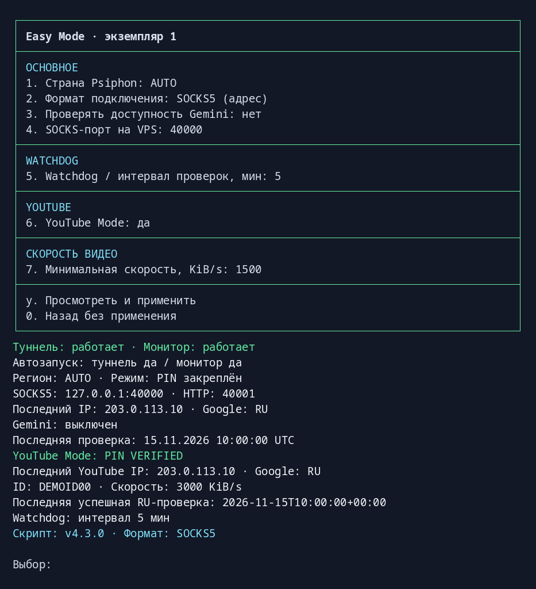

<div align="center">


# Forcus Auto-Pin

**SOCKS5 محلي · تثبيت تلقائي للخادم · فحص Google/Gemini · استعادة الاتصال**


[](LICENSE)

[English](README.md) · [فارسی](README.fa_IR.md) · **العربية** · [中文](README.zh_CN.md) · [Español](README.es_ES.md) · [Русский](README.ru_RU.md) · [Türkçe](README.tr_TR.md)

</div>

<div dir="rtl">

مدير Psiphon لخوادم Linux VPS. ثبّت البرنامج واختر Easy أو Advanced، ثم أدر نسخ البروكسي المستقلة من الطرفية. يستطيع Xray استخدام نقطة SOCKS5 نفسها عبر ملف outbound JSON الذي ينشئه البرنامج.

[البدء السريع](#quick-start) · [الميزات](#features) · [قائمة الطرفية](#menu) · [مرجع الأوامر](#commands) · [التكامل مع Xray](#xray) · [التحديث والصيانة](#operations) · [إزالة التثبيت](#uninstall) · [الأسئلة الشائعة](#faq)

[YouTube Mode](#youtube) · [الأمان](#security)

<a id="quick-start"></a>

## البدء السريع

نفّذ الأوامر بصلاحية root داخل Bash. الأنظمة المدعومة Ubuntu/Debian بمعمارية x86_64 مع systemd؛ يلزم الإنترنت وcurl. يثبّت البرنامج Docker/Go عند غيابهما ويحافظ على التثبيت الموجود.

يتطلب المصدّر Go 1.22؛ يمكن لـGo 1.21+ اختيار toolchain أحدث مع فحص checksum. يُرفض Go الأقدم قبل إيقاف الخدمات دون استبدال تثبيته.

نزّل المثبّت وشغّله. تشغيله دون معاملات في الطرفية يفتح قائمة الإعداد:

<div dir="ltr" align="left">

```bash
curl -fsSL https://raw.githubusercontent.com/Forcus356/Psiphon-Auto-Pin-Manager/main/install_psiphon_autopin.sh -o /tmp/install_psiphon_autopin.sh && bash /tmp/install_psiphon_autopin.sh
```

</div>

بعد التثبيت يمكنك فتح القائمة في أي وقت:

<div dir="ltr" align="left">

```bash
auto-pin
```

</div>

**SOCKS5:** `127.0.0.1:40000` → `1080`  ·  **HTTP:** `127.0.0.1:40001` → `8080`

التوثيق متاح بسبع لغات. القائمة الطرفية تستخدم حاليًا تسميات روسية، والأوامر والخيارات موحّدة في جميع الأدلة.

<a id="features"></a>

## الميزات

- تثبيت PIN أول تلقائي: إنشاء ذاكرة التخزين وإعادة الاتصال بالخادم المحدد والتحقق قبل إعلان التثبيت.
- نفق واحد مع PIN موثّق أو مجموعة من 2–32 نفقًا مع فحوص بأخذ عينات.
- حتى 99 نسخة مستقلة بمنافذ وملفات وقواعد بيانات وأقفال وخدمات منفصلة.
- مجموعات دول وقائمة دول Google المحظورة ومطابقة صارمة اختيارية للدولة.
- فحص Gemini اختياري وبصمة TLS لمتصفح لاكتشاف CAPTCHA.
- عتبة سرعة تؤكدها قياسات متتالية واستعادة تلقائية للاتصال.
- SOCKS5 محلي وHTTP اختياري وربط IPv4 خاص وoutbound JSON لـXray.
- إزالة تراعي مصدر Docker/Go وتحتفظ بالتثبيت السابق واعتماد التطبيقات الأخرى.

<a id="menu"></a>

## قائمة الطرفية

بعد التثبيت أو التطبيق التفاعلي تُفتح قائمة auto-pin الرئيسية للنسخة المختارة تلقائيًا. يظهر بوضوح أن البحث أو فحص IP لم يكتمل؛ تشغيل الخدمة لا يعني خروجًا موثّقًا. اضغط **r** لتحديث النتيجة المحفوظة المعروضة دون فحص شبكة جديد. تنتهي الأتمتة غير التفاعلية طبيعيًا.

**Easy:** الدولة، صيغة الاتصال، Gemini، منفذ SOCKS وفترة watchdog بالدقائق. **Advanced:** جميع خيارات المثبّت. البندان 3 و4 في القائمة الرئيسية للإدارة واختيار النسخة.

يتوفر **YouTube Mode** في البند **6** من Easy وفي Advanced؛ يبقى watchdog في البند 5. إذا كان Gemini مفعّلًا تقترح القائمة نسخة مستقلة بمنافذ حرة. لا تغيّر النسخة الأصلية؛ استبدال وضعها يحتاج اختيارًا وتأكيدًا صريحين.

عند تفعيل YouTube يظهر البند **7** في Easy لعتبة سرعة الفيديو.

Enter يحتفظ بالقيمة، و`-` يمسح قائمة الدول. الحرف اللاتيني `y` يعرض الإعدادات ويطبقها بعد تأكيد `y/n`. الإلغاء يحفظ الإعدادات السابقة. قد يعيد التطبيق اتصال النفق المحدد. يحتفظ Easy بقيم Advanced المخفية.

يعرض تذييل القائمة النتائج المحفوظة؛ فتح القائمة لا ينفذ فحص شبكة جديدًا. استخدم `check`. يعطّل `NO_COLOR=1 auto-pin` الألوان، ويستخدم `TERM=dumb auto-pin` إطار ASCII.

<details>
<summary>معاينة القائمة</summary>

مثال من عارض القائمة الحالي؛ العناوين والحالات في الصورة بيانات توضيحية.




[Easy Mode (.txt)](docs/assets/easy-mode-demo.txt)

[معاينة القائمة (.txt)](docs/assets/menu-demo.txt)

</details>

<a id="examples"></a>

## أمثلة التثبيت

ينزّل كل مثال المثبّت ويشغّله دون قائمة. الخيارات الصريحة تستبدل القيم المحفوظة، وتبقى بقية الإعدادات عند التحديث.

<details>
<summary>أمثلة التثبيت</summary>

### دون فحص Gemini

<div dir="ltr" align="left">

```bash
bash <(curl -fsSL https://raw.githubusercontent.com/Forcus356/Psiphon-Auto-Pin-Manager/main/install_psiphon_autopin.sh) --region NL --no-gemini-check
```

</div>

### مجموعة دول وحد أدنى للسرعة

<div dir="ltr" align="left">

```bash
bash <(curl -fsSL https://raw.githubusercontent.com/Forcus356/Psiphon-Auto-Pin-Manager/main/install_psiphon_autopin.sh) --region NL,DE,PL --min-speed 1000
```

</div>

### نسخة ثانية مستقلة

<div dir="ltr" align="left">

```bash
bash <(curl -fsSL https://raw.githubusercontent.com/Forcus356/Psiphon-Auto-Pin-Manager/main/install_psiphon_autopin.sh) --instance 2 --region DE --port 40002
```

</div>

### نشر SOCKS5 فقط

<div dir="ltr" align="left">

```bash
bash <(curl -fsSL https://raw.githubusercontent.com/Forcus356/Psiphon-Auto-Pin-Manager/main/install_psiphon_autopin.sh) --region NL --no-http
```

</div>

### إنشاء ملف اتصال Xray

<div dir="ltr" align="left">

```bash
bash <(curl -fsSL https://raw.githubusercontent.com/Forcus356/Psiphon-Auto-Pin-Manager/main/install_psiphon_autopin.sh) --region NL --connection xray
```

</div>

### ثلاثة أنفاق وwatchdog كل 10 دقائق

<div dir="ltr" align="left">

```bash
bash <(curl -fsSL https://raw.githubusercontent.com/Forcus356/Psiphon-Auto-Pin-Manager/main/install_psiphon_autopin.sh) --region NL --tunnel-pool 3 --interval 600
```

</div>

### Gemini مع بصمة TLS لمتصفح

<div dir="ltr" align="left">

```bash
bash <(curl -fsSL https://raw.githubusercontent.com/Forcus356/Psiphon-Auto-Pin-Manager/main/install_psiphon_autopin.sh) --region NL --gemini-check --impersonate
```

</div>

</details>

<a id="commands"></a>

## مرجع الأوامر

| الأمر | الوظيفة |
| --- | --- |
| `psiphon-autopin xray-routing --youtube-instance 2 --gemini-instance 1` | تصدير التوجيه بالمنافذ المحفوظة. |
| `psiphon-autopin update` | التحديث من auto-pin. |
| `auto-pin` | فتح قائمة الإعداد والإدارة. |
| `auto-pin --instance 2` | فتح قائمة النسخة 2. |
| `psiphon-autopin status` | عرض الإعدادات المحفوظة وآخر نتيجة. |
| `psiphon-autopin check` | إجراء فحص جديد للاتصال والسياسات. |
| `psiphon-autopin rotate` | طلب تبديل الخادم. |
| `psiphon-autopin region NL` | التبديل إلى NL ومسح مجموعة الدول السابقة. |
| `psiphon-autopin pool NL,DE,PL` | تعيين مجموعة دول بديلة. |
| `psiphon-autopin pool ''` | مسح مجموعة الدول. |
| `psiphon-autopin speed` | قياس السرعة عبر Psiphon. |
| `psiphon-autopin logs 100` | عرض السجلات الحديثة للمراقب والنفق. |
| `psiphon-autopin start` | بدء النسخة المحددة. |
| `psiphon-autopin stop` | إيقاف النسخة المحددة. |
| `psiphon-autopin restart` | إعادة تشغيل النسخة المحددة. |
| `psiphon-autopin xray` | طباعة SOCKS outbound JSON لـXray. |
| `psiphon-autopin-2 status` | عرض حالة النسخة 2. |
| `psiphon-autopin menu` | فتح القائمة من واجهة الأوامر الأصلية. |
| `vps-psiphon status` | اسم بديل متوافق للمدير نفسه. |
| `psiphon-autopin refresh-cache --allow-interruption` | تحديث ذاكرة قاعدة البيانات؛ يقطع النفق. |
| `psiphon-autopin prepare-pin` | تحضير PIN لإعادة تشغيل لاحقة. |
| `psiphon-autopin search` | البحث عن خادم مناسب. |
| `psiphon-autopin monitor` | مدخل المراقب الداخلي؛ يشغّله systemd عادةً. |

`set-region --region NL` و`set-pool --region-pool NL,DE` هما الصيغتان الكاملتان لـ`region NL` و`pool NL,DE`. قد تغيّر خيارات التشغيل سياسة أمر واحد؛ لحفظ إعداد الخدمة الكامل استخدم القائمة أو المثبّت.

<div dir="ltr" align="left">

```bash
psiphon-autopin set-region --region NL
psiphon-autopin set-pool --region-pool NL,DE
```

</div>

رموز خروج `check`: **0** نتيجة مقبولة، **2** رفض السياسة بما فيه انخفاض السرعة، **1** خطأ فحص أو تشغيل. قد تتضمن النتيجة المقبولة Gemini `INCONCLUSIVE`.

<a id="youtube"></a>

## YouTube Mode

اختياري و**معطّل افتراضيًا**. يقبل فقط **Google GeoIP = RU** من صفحة YouTube عبر SOCKS5h لهذه النسخة. التحقق يخص الدولة وPIN الخادم، ولا يثبت غياب الإعلانات.

يتطلب YouTube نفقًا واحدًا وloopback وتعطيل Gemini في النسخة نفسها. يمكن أن تكون دولة Psiphon AUTO أو دولة مختارة؛ لا تُغيّر تلقائيًا إلى RU. يفرض Google RU بدل شرط deny/strict العادي مع حفظ القيم الأصلية. تُعاد محاولة UNKNOWN ولا تُقبل. تبقى التأخيرات وعتبات السرعة والذاكرة والمرشحون الاحتياطيون وتوثيق PIN.

الافتراضي لنسخ YouTube الجديدة هو **1500 KiB/s ≈ 12.3 Mbps** مع حفظ القيم السابقة أو الصريحة. **4 MiB حجم عينة الفحص** وليس حد السرعة. يظهر البند **7** في Easy لضبط عتبة الفيديو عند تفعيل YouTube؛ ويبقى Advanced و--min-speed متاحين. الفحص القصير لا يضمن جودة الفيديو المستمرة.

مثال لـVPS نظيف: Gemini في النسخة 1 (40000)، وYouTube في النسخة 2 (40002). في تثبيت قائم اختر أرقامًا ومنافذ حرة واحتفظ بإعداد Gemini العامل. أمر Gemini التالي للإعداد الأولي.

<div dir="ltr" align="left">

```bash
curl -fsSL https://raw.githubusercontent.com/Forcus356/Psiphon-Auto-Pin-Manager/main/install_psiphon_autopin.sh -o /tmp/install_psiphon_autopin.sh
```

</div>

### نسخة Gemini

<div dir="ltr" align="left">

```bash
bash /tmp/install_psiphon_autopin.sh --instance 1 --region NL --gemini-check --no-youtube-mode
```

</div>

### نسخة YouTube

<div dir="ltr" align="left">

```bash
bash /tmp/install_psiphon_autopin.sh --instance 2 --region AUTO --youtube-mode --no-gemini-check --tunnel-pool 1
```

</div>

عطّل من القائمة أو أعد المثبّت مع --instance 2 --no-youtube-mode. لا تتغير النسخ الأخرى أو قيمة Gemini الحالية. غياب youtube_mode في JSON قديم يعني false. تبقى مجموعات 2–32 نفقًا مدعومة مع تعطيل YouTube.

يتضمن الوضع IP المرصود ودولة Google والمعرّف والسرعة وPIN وآخر فحص RU ناجح. بعد إعادة تشغيل النظام أو الحاوية أو تقادم البيانات يلزم فحص جديد.

| Status | الوظيفة |
| --- | --- |
| `DISABLED` | الوضع معطّل. |
| `SEARCHING` | البحث عن Google RU. |
| `RU VERIFIED` | تأكد RU ولم يُوثّق PIN بعد. |
| `PIN VERIFIED` | تم التحقق من RU وPIN الخادم المختار. |
| `DEGRADED` | مشكلة اتصال أو سرعة. |
| `UNKNOWN` | لا توجد نتيجة GeoIP حالية موثوقة. |

### تصدير التوجيه بالمنافذ المحفوظة

<div dir="ltr" align="left">

```bash
psiphon-autopin xray-routing --youtube-instance 2 --gemini-instance 1
```

</div>

أضف outbounds المصدّرة **بعد outbound الافتراضي الموجود**، وضع قواعد النطاقات قبل القواعد العامة. فعّل sniffing على inbounds الفعلية أو مرّر أسماء الوجهة عبر SOCKS/VLESS. استخدم شبكة host لـXray داخل Docker. بروكسي TCP لا يحمل QUIC؛ يحجب المثال UDP/443 فقط لنطاقات الخدمات المحددة لتسمح للعملاء بالرجوع إلى TCP. قد لا تُعرف الأسماء المخفية أو المشفرة. لا يُغيّر إعداد Xray تلقائيًا.

[JSON + sniffing](docs/xray/README.md)

<a id="xray"></a>

## التكامل مع Xray

المسار هو **Xray → SOCKS5 → Psiphon → Internet**. يطبع الأمر xray إعداد outbound؛ ويحفظ --connection xray ملف xray-outbound.json أيضًا. أضف outbound وقواعد التوجيه إلى إعداد Xray بنفسك. الاتصال يستخدم SOCKS5 نفسه ولا ينشئ بروتوكول نقل مستقلًا.

<div dir="ltr" align="left">

```bash
psiphon-autopin xray
```

</div>

<div dir="ltr" align="left">

```json
{
  "tag": "psiphon-out",
  "protocol": "socks",
  "settings": {
    "servers": [{"address": "127.0.0.1", "port": 40000}]
  }
}
```

</div>

في شبكة Docker bridge يشير 127.0.0.1 إلى حاوية Xray نفسها. استخدم شبكة host أو عنوان IPv4 خاصًا موجودًا على VPS عبر --bind. الربط بعنوان عام مرفوض. البروكسي مخصص لـTCP.

<a id="options"></a>

## خيارات المثبّت

القائمة تضبط watchdog بالدقائق. يستخدم --interval وحقل JSON interval الثواني دائمًا. استبدل الدول والمنافذ في الأمثلة بما يناسبك.

التثبيت الجديد مع `auto` يستخدم `vps-psiphon` ويحافظ على الخلفية الموجودة المعروفة. تتطلب `console` الربط بـloopback. يبقي `--no-gemini-check` فحوص الدولة والسرعة والاستعادة.

<details>
<summary>خيارات المثبّت</summary>

| الخيار | الافتراضي | الوظيفة |
| --- | --- | --- |
| `--youtube-mode` / `--no-youtube-mode` | معطّل | فرض Google RU وPIN موثّق لنفق واحد؛ يتعارض مع Gemini في النسخة نفسها. |
| `--region NL / --region AUTO / --region NL,DE` | اختيار بالقائمة / مطلوب للتثبيت غير التفاعلي (NL) | رمز دولة Psiphon من حرفين أو AUTO أو دول مفصولة بفواصل. |
| `--instance N` | 1 | اختيار النسخة 1–99. |
| `--port N` | 40000 + 2 × (N−1) | منفذ SOCKS من 1024 إلى 65534؛ يستخدم HTTP المنفذ التالي. |
| `--connection socks5\|xray` | socks5 | حفظ عنوان SOCKS5 أو مخرج Xray JSON. |
| `--menu / --interactive` | TTY / 0 args | فتح المعالج صراحةً؛ يمكن إضافة --instance N. |
| `--menu-mode easy\|advanced` | easy | تذكّر وضع Easy أو Advanced. |
| `--region-pool NL,DE` | فارغ | قائمة الدول البديلة. |
| `--bind ADDR` | 127.0.0.1 | الربط بـloopback أو IPv4 خاص موجود. |
| `--bind-loopback` | 127.0.0.1 | إعادة الربط إلى 127.0.0.1. |
| `--http / --no-http` | مفعّل | تفعيل/تعطيل نشر HTTP. |
| `--gemini-check / --no-gemini-check` | مفعّل | تفعيل/تعطيل فحص Gemini. |
| `--impersonate / --no-impersonate` | معطّل | تفعيل/تعطيل TLS المتصفح لفحص صفحة Gemini. |
| `--strict-region / --no-strict-region` | معطّل | تفعيل/تعطيل التطابق الصارم لدولة Google. |
| `--interval N` | 300 s | الفترة العادية بالثواني؛ الحد الأدنى 60. |
| `--wait N` | 75 s | مهلة الجاهزية بالثواني؛ الحد الأدنى 20. |
| `--delay N` | 12 s | الفاصل بين محاولات البحث بالثواني؛ الحد الأدنى 2. |
| `--min-speed N` | 800 / 1500 (YouTube) KiB/s | حد KiB/s؛ القيمة 0 تعطّل التبديل بسبب السرعة. |
| `--probe-mb N` | 4 MiB | عينة 0–10 MiB؛ الصفر مع عتبة مفعّلة يقيس صفحة. |
| `--slow-threshold N` | 2 | قياسات بطيئة متتالية قبل التبديل، 2–20. |
| `--fail-threshold N` | 3 | إخفاقات متتالية قبل الاستعادة، 2–20. |
| `--deny-regions 'RU BY IR SY CU KP CN VE'` | RU BY IR SY CU KP CN VE | دول Google المحظورة؛ النص الفارغ يمسح القائمة. |
| `--tunnel-pool N` | 1 | 1 يستخدم PIN؛ و2–32 مجموعة دون PIN واحد ثابت. |
| `--backend auto\|console\|vps-psiphon` | auto | كشف/حفظ الخلفية الموجودة أو اختيارها صراحةً. |
| `--help` | — | عرض مساعدة المثبّت. |

</details>

<a id="operations"></a>

## التحديث والصيانة

### التحديث من auto-pin

البند **5 — Update Auto-Pin (GitHub)** يحدّث النسخة المثبّتة المختارة مع حفظ إعداداتها. لا تتغير النسخ الأخرى؛ اخترها من البند 4 لتحديثها. يثبت main على commit محدد ويفحص Git blob وصياغة Bash ويعرض الإصدار/commit/SHA-256 قبل طلب التأكيد. لا يُشغّل المثبّت عند خطأ الشبكة أو التحقق، ويُرفض الرجوع لإصدار أقدم. بعد النجاح تُفتح القائمة الرئيسية المحدّثة تلقائيًا.

تفتح هذه الأوامر نفس إجراء التحديث المؤكد. تتاح الوظيفة بعد التثبيت الأول لهذا الإصدار؛ انشر جميع ملفات الإصدار في مستودعك قبل استخدامها.

<div dir="ltr" align="left">

```bash
auto-pin --update
psiphon-autopin update
psiphon-autopin-2 update
```

</div>

يُختار أحدث منيو مثبّت؛ وجود نسخة أولى قديمة لا يخفي الميزات الجديدة.

### تحديث نسخة موجودة

نزّل المثبّت الحالي مجددًا وطبّقه على النسخة. تُحفظ الإعدادات السابقة ما لم تستبدلها خيارات صريحة. فتح auto-pin وحده لا ينزّل نسخة جديدة.

<div dir="ltr" align="left">

```bash
curl -fsSL https://raw.githubusercontent.com/Forcus356/Psiphon-Auto-Pin-Manager/main/install_psiphon_autopin.sh -o /tmp/install_psiphon_autopin.sh && bash /tmp/install_psiphon_autopin.sh --instance 1
```

</div>

### التشخيص

راجع الحالة وتابع سجل المراقب وحده واختبر البروكسيين المضبوطين:

<div dir="ltr" align="left">

```bash
psiphon-autopin status
journalctl -u psiphon-autopin.service -n 100 --no-pager
journalctl -u psiphon-autopin.service -f
systemctl status vps-psiphon.service psiphon-autopin.service --no-pager
```

</div>

<div dir="ltr" align="left">

```bash
curl -4 -fsS --noproxy '' --proxy socks5h://127.0.0.1:40000 https://api.ipify.org
```

</div>

<div dir="ltr" align="left">

```bash
curl -4 -fsS --noproxy '' --proxy http://127.0.0.1:40001 https://api.ipify.org
```

</div>

تستخدم فحوص الاتصال وIP والدولة وGemini والسرعة SOCKS مع DNS بعيد دون رجوع لاتصال مباشر. قد تستخدم تنزيلات المثبّت شبكة VPS. لا يُحذف WARP تلقائيًا.

### نسخ مستقلة

استخدم psiphon-autopin-N أو auto-pin --instance N. منافذ المضيف الافتراضية أدناه ويمكن تغييرها عبر --port. حدود 99 نسخة و32 نفقًا هي حدود إعداد، وليست ضمانًا لقدرة VPS.

| # | SOCKS5 | HTTP | CLI |
| --- | --- | --- | --- |
| 1 | `40000` | `40001` | `psiphon-autopin` |
| 2 | `40002` | `40003` | `psiphon-autopin-2` |
| 3 | `40004` | `40005` | `psiphon-autopin-3` |

### Watchdog واستهلاك البيانات

البند 5 في Easy وإعدادات Advanced يضبطان فترة المراقب الداخلي بالدقائق: الحد الأدنى 1 والافتراضي 5. تُقبل كسور مثل 1.5 إذا قابلت ثواني صحيحة. قد تتكرر المحاولات عند الفشل أسرع. لا يعمل watchdog إضافي من Chara.

الافتراضي: Gemini مفعّل، نفق واحد، 800 KiB/s، قياسان بطيئان، عينة 4 MiB واستعادة بعد ثلاثة إخفاقات. عينة 4 MiB كل خمس دقائق تستهلك نحو 34 GiB في 30 يومًا قبل بيانات البحث. --min-speed 0 يعطّل التبديل بسبب السرعة؛ --probe-mb 0 وحده قد يظل يقيس صفحة.

<a id="uninstall"></a>

## إزالة التثبيت

إزالة النسخة المحددة مع الاحتفاظ بـDocker/Go:

<div dir="ltr" align="left">

```bash
psiphon-autopin uninstall
```

</div>

إزالة النسخة وحزم Docker/Go المؤهلة التي ثبّتها هذا المدير:

<div dir="ltr" align="left">

```bash
psiphon-autopin uninstall --purge-deps
```

</div>

<div dir="ltr" align="left">

```bash
psiphon-autopin-2 uninstall --purge-deps
```

</div>

من الإصدار 4.2 يُسجّل مصدر كل مكوّن. تبقى الحزم السابقة أو مجهولة المصدر. تحفظ نسخ Auto-Pin الأخرى الاعتمادات المشتركة؛ وتحفظ الحاويات الأخرى، حتى المتوقفة، أو الاستخدام المجهول Docker. تمنع محاكاة APT إزالة الحزم غير المرتبطة.

التثبيتات القديمة دون سجل مصدر تحتفظ بالاعتمادات. لا يُستخدم autoremove ولا تُحذف بيانات Docker عشوائيًا. تبقى Python وcurl وGCC ونسخ الترحيل الاحتياطية. البندان 13 و14 في القائمة يقدمان طريقتي الإزالة.

الإزالة العادية لآخر نسخة تتخلى عن سجل الملكية وتحتفظ بالاعتمادات. اختر `--purge-deps` عند الإزالة لحذف الاعتمادات المملوكة المؤهلة أيضًا.

إذا فشل تنظيف APT، يُبلّغ الأمر عن الفشل ويحفظ السجل. بعد إصلاح APT أعد المحاولة من مجلد المشروع الذي نزّلته:

<div dir="ltr" align="left">

```bash
python3 autopin_system.py cleanup --purge
```

</div>

<a id="faq"></a>

## الأسئلة الشائعة

<details>
<summary>كيف أعرف أن PIN موثّق؟</summary>

ابحث عن INITIAL PIN VERIFIED وadopted_unpinned: false. أما pin_prepared: true فيعني التحضير فقط. إنشاء PIN الأول يعيد الاتصال بصورة مضبوطة؛ فشل التحقق يعيد الحالة السابقة ويحاول في دورة صحة لاحقة.

</details>

<details>
<summary>هل INCONCLUSIVE يعني أن Gemini يعمل؟</summary>

لم تُؤكد إجابة النموذج. SERVING يعني نجاح الفحص المجهول؛ INCONCLUSIVE نتيجة غير محسومة ولا تسبب التبديل وحدها. تسمح السياسة الحالية بتوثيق PIN مع Gemini غير محسوم. لا يُفحص حسابك المسجل بالمتصفح.

</details>

<details>
<summary>لماذا يختلف ip عن server_ip؟</summary>

ip هو عنوان الخروج العام للبروكسي، وserver_ip عنوان خادم Psiphon. قد يتغير عنوان الخروج بعد إعادة الاتصال حتى بالخادم المثبّت نفسه؛ لا يوجد ضمان لثبات IP.

</details>

<details>
<summary>لماذا يُطلب تكرار y أحيانًا؟</summary>

يُرفض إدخال UTF-8 التالف بدل تطبيقه أو إغلاق القائمة. أعد كتابة الحرف اللاتيني y ثم أكّد بـy/n.

</details>

<details>
<summary>لماذا يعرض Google دولة مختلفة؟</summary>

EgressRegion يطلب منطقة من Psiphon؛ وقد يصنّف Google عنوان الخروج بشكل مختلف. تحدد قائمة الحظر وstrict-region القبول. لا تُضمن دولة محددة أو إمكانية الوصول إلى خدمة.

</details>

<a id="files"></a>

## الملفات والإعدادات

المسارات للنسخة 1. تُضاف -N لمجلدات التطبيق والبيانات والإعداد للنسخ الأخرى؛ سجل المصدر ومجلد النسخ الاحتياطية مشتركان. ملفات الاتصال ومداخل الخوادم تتضمن إعدادات خاصة.

| المسار | الوظيفة |
| --- | --- |
| `/var/lib/psiphon-autopin/youtube-status.json` | آخر رصد YouTube وبيانات التحقق من حداثته. |
| `/var/lib/psiphon-autopin/update-source.json` | commit وبصمة المصدر لآخر تحديث ناجح من القائمة. |
| `/var/lib/psiphon-autopin/settings.json` | الإعدادات الفعلية وتفضيلات القائمة. |
| `/var/lib/psiphon-autopin/state.json` | آخر نتيجة مراقبة وحالة PIN. |
| `/opt/vps-psiphon/config/psiphon.config` | إعداد Psiphon الخاص ومدخل الخادم المستهدف. |
| `/var/lib/psiphon-autopin/server-entry-cache.json` | ذاكرة خاصة لمداخل الخوادم. |
| `/var/lib/psiphon-autopin/connection.json` | مخرج الاتصال المحدد. |
| `/var/lib/psiphon-autopin/xray-outbound.json` | outbound لـXray عند اختيار هذه الصيغة. |
| `/var/lib/psiphon-autopin-system/dependencies.json` | سجل مصدر Docker/Go بصلاحية 0600. |
| `/var/backups/psiphon-autopin` | نسخ احتياطية للترحيل والاستعادة. |

<a id="security"></a>

## الأمان

صور Psiphon وDebian مثبّتة بـdigest. يأتي ConsoleClient من commit ثابت ويُفحص SHA-256 قبل الاستخدام بما فيه التحديث. تستخدم الحاويات UID 1000 دون capabilities، وجذرًا للقراءة فقط وno-new-privileges. يقيّد systemd ملفات وقدرات الخدمات؛ ما زال متحكم Docker يحتاج صلاحيات تعادل root. يبقى --bind الخاص الصريح خارج YouTube. راجع ملاحظات الأمان.

[SECURITY.md](SECURITY.md) · [SECURITY.ru_RU.md](SECURITY.ru_RU.md)

<a id="development"></a>

## التطوير والشكر

من نسخة محلية للمشروع:

<div dir="ltr" align="left">

```bash
python3 -m unittest discover -s tests -v
bash -n install_psiphon_autopin.sh
```

</div>

[CHANGELOG](CHANGELOG.md) · [tests](tests)

المكوّنات المستخدمة: [Psiphon Tunnel Core](https://github.com/Psiphon-Labs/psiphon-tunnel-core), [psiphon-docker](https://github.com/swarupsengupta2007/psiphon-docker), [bbolt](https://github.com/etcd-io/bbolt), [curl-impersonate](https://github.com/lexiforest/curl-impersonate).

الترخيص [GPL-3.0](LICENSE). دُرست أفكار تشغيلية من [Chara vps-psiphon](https://github.com/Chara-Freedom/vps-psiphon)؛ المثبّت وwatchdog الخاصان به ليسا جزءًا من تشغيل هذا المشروع. تنظيم README مستوحى من [3x-ui](https://github.com/MHSanaei/3x-ui).

</div>
