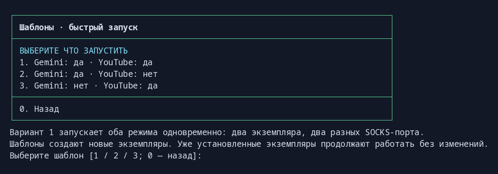

<div align="center">


# Forcus Auto-Pin

**SOCKS5 محلی · تثبیت خودکار سرور · بررسی Google/Gemini · بازیابی**


[](LICENSE)

[English](README.md) · **فارسی** · [العربية](README.ar_EG.md) · [中文](README.zh_CN.md) · [Español](README.es_ES.md) · [Русский](README.ru_RU.md) · [Türkçe](README.tr_TR.md)

</div>

<div dir="rtl">

مدیر Psiphon برای سرورهای لینوکس VPS. پس از نصب، Easy یا Advanced را انتخاب کنید و نمونه‌های مستقل پراکسی را از کنسول مدیریت کنید. Xray با فایل outbound JSON تولیدشده به همان SOCKS5 متصل می‌شود.

[شروع سریع](#quick-start) · [امکانات](#features) · [منوی کنسول](#menu) · [مرجع فرمان‌ها](#commands) · [اتصال Xray](#xray) · [به‌روزرسانی و نگهداری](#operations) · [حذف](#uninstall) · [پرسش‌های رایج](#faq)

[YouTube Mode](#youtube) · [امنیت](#security)

<a id="quick-start"></a>

## شروع سریع

فرمان‌ها را در Bash با کاربر root اجرا کنید. Ubuntu/Debian با معماری x86_64 و systemd پشتیبانی می‌شود؛ اینترنت و curl لازم است. نصب‌کننده Docker/Go موردنیاز را نصب می‌کند و نصب‌های موجود را حفظ می‌کند.

خروجی‌گیر به Go 1.22 نیاز دارد؛ Go 1.21+ می‌تواند toolchain تازه با بررسی checksum انتخاب کند. Go قدیمی پیش از توقف سرویس رد می‌شود و نصب موجود جایگزین نمی‌شود.

نصب‌کننده را دریافت و اجرا کنید. اجرای بدون آرگومان در ترمینال، منوی تنظیمات را باز می‌کند:

<div dir="ltr" align="left">

```bash
curl -fsSL https://raw.githubusercontent.com/Forcus356/Psiphon-Auto-Pin-Manager/main/install_psiphon_autopin.sh -o /tmp/install_psiphon_autopin.sh && bash /tmp/install_psiphon_autopin.sh
```

</div>

پس از نصب، هر زمان می‌توانید منو را دوباره باز کنید:

<div dir="ltr" align="left">

```bash
auto-pin
```

</div>

**SOCKS5:** `127.0.0.1:40000` → `1080`  ·  **HTTP:** `127.0.0.1:40001` → `8080`

راهنما به هفت زبان ارائه می‌شود. برچسب‌های منوی کنسول فعلاً روسی هستند؛ فرمان‌ها و گزینه‌ها در همه راهنماها یکسان‌اند.

<a id="features"></a>

## امکانات

- PIN اولیه خودکار: ساخت حافظه نهان، اتصال دوباره به سرور انتخابی و تأیید پیش از اعلام تثبیت.
- یک تونل با PIN تأییدشده یا مجموعه ۲ تا ۳۲ تونل با بررسی نمونه‌ای.
- تا ۹۹ نمونه مستقل با پورت، فایل، پایگاه داده، قفل و سرویس جداگانه.
- مجموعه کشورها، فهرست کشورهای ممنوع Google و تطابق سخت‌گیرانه اختیاری کشور.
- بررسی اختیاری Gemini و نمایه TLS مرورگر برای تشخیص CAPTCHA.
- آستانه سرعت با تأیید اندازه‌گیری‌های متوالی و بازیابی خودکار اتصال.
- SOCKS5 محلی، HTTP اختیاری، اتصال به IPv4 خصوصی و outbound JSON برای Xray.
- حذف با حفظ Docker/Go از قبل نصب‌شده و وابستگی‌های مورد استفاده دیگران.

<a id="menu"></a>

## منوی کنسول

**قالب‌ها — راه‌اندازی سریع:** گزینهٔ **t** در بالای منوی اصلی است. در VPS تازه، Enter نیز قالب‌ها را باز می‌کند. سه انتخاب: **1 — Gemini: بله / YouTube: بله**، **2 — Gemini: بله / YouTube: خیر**، **3 — Gemini: خیر / YouTube: بله**.

برای نصب هر دو: **Enter → 1 → y → y**. راهنما دو نمونهٔ مستقل با پورت‌های SOCKS/HTTP جدا نشان می‌دهد. اگر پورت‌های استاندارد آزاد باشند، Gemini از `127.0.0.1:40000` و YouTube از `127.0.0.1:40002` استفاده می‌کند؛ منطقهٔ YouTube برابر AUTO، کشور اجباری Google برابر RU و حداقل سرعت اولیه 1500 KiB/s است. پیش از تأیید می‌توان منطقه، پورت‌ها، watchdog، قالب اتصال و حداقل سرعت YouTube را تغییر داد. با یک تأیید مشترک، نصب به‌ترتیب انجام می‌شود و سپس هر دو مانیتور هم‌زمان کار می‌کنند. منوی اصلی دوباره باز می‌شود؛ گزینهٔ **4** نمونهٔ نمایش‌داده‌شده را بدون توقف دیگران عوض می‌کند.

قالب‌ها نمونه‌های **جدید** می‌سازند و نمونه‌های موجود را حفظ می‌کنند. برای ویرایش نمونهٔ موجود از Easy / Advanced استفاده کنید. اگر نصب دوم شکست بخورد، اولی حفظ می‌شود و نتیجهٔ ناقص صریحاً گزارش می‌شود. شروع سرویس به‌معنای تأیید IP یا PIN نیست.

پرسش‌های روشن/خاموش توضیح می‌دهند: **1 — فعال، 0 — غیرفعال، Enter — حفظ مقدار فعلی**؛ да/нет و y/n نیز پذیرفته می‌شوند. در تأیید نصب، y یا 1 یعنی بله، n یا 0 یعنی خیر و Enter یعنی لغو.

پس از نصب یا اعمال تعاملی، منوی اصلی auto-pin برای نمونه انتخابی خودکار باز می‌شود. اگر جست‌وجو/بررسی IP تمام نشده باشد مشخص می‌شود؛ شروع سرویس به معنی خروجی تأییدشده نیست. برای تازه‌کردن نتیجه ذخیره‌شده، بدون آزمون تازه شبکه، **r** را بزنید. اجرای غیرتعاملی معمول تمام می‌شود.

**Easy:** کشور، قالب اتصال، Gemini، پورت SOCKS و دوره watchdog به دقیقه. **Advanced:** همه گزینه‌های نصب. گزینه‌های ۳ و ۴ منوی اصلی برای مدیریت و انتخاب نمونه هستند.

گزینه **۶** Easy و تنظیمات Advanced شامل **YouTube Mode** هستند؛ watchdog گزینه ۵ می‌ماند. اگر Gemini روشن باشد، منو نمونه مستقل با پورت آزاد پیشنهاد می‌دهد. نمونه اصلی تغییر نمی‌کند؛ جایگزینی حالت فعلی نیازمند انتخاب و تأیید صریح است.

با روشن‌بودن YouTube، گزینه **۷** Easy برای آستانه سرعت ویدیو اضافه می‌شود.

Enter مقدار را نگه می‌دارد؛ `-` فهرست کشورها را پاک می‌کند. حرف لاتین `y` تنظیمات را نمایش می‌دهد و پس از تأیید `y/n` اعمال می‌کند. لغو، تنظیمات قبلی را حفظ می‌کند. اعمال ممکن است تونل انتخابی را دوباره متصل کند. Easy مقادیر پنهان Advanced را حفظ می‌کند.

پایین منو نتایج ذخیره‌شده را نشان می‌دهد؛ بازکردن منو بررسی تازه شبکه انجام نمی‌دهد. از `check` استفاده کنید. `NO_COLOR=1 auto-pin` رنگ را خاموش می‌کند؛ `TERM=dumb auto-pin` قاب ASCII می‌دهد.

<details>
<summary>پیش‌نمایش منو</summary>

نمونه خروجی نمایشگر فعلی منو؛ نشانی‌ها و وضعیت‌های تصویر نمایشی هستند.




[Templates (.txt)](docs/assets/templates-demo.txt)

[Easy Mode (.txt)](docs/assets/easy-mode-demo.txt)

[پیش‌نمایش منو (.txt)](docs/assets/menu-demo.txt)

</details>

<a id="examples"></a>

## نمونه‌های نصب

هر نمونه، نصب‌کننده را دریافت و بدون منو اجرا می‌کند. گزینه‌های صریح، مقادیر ذخیره‌شده را جایگزین می‌کنند؛ تنظیمات دیگر در به‌روزرسانی حفظ می‌شوند.

<details>
<summary>نمونه‌های نصب</summary>

### بدون بررسی Gemini

<div dir="ltr" align="left">

```bash
bash <(curl -fsSL https://raw.githubusercontent.com/Forcus356/Psiphon-Auto-Pin-Manager/main/install_psiphon_autopin.sh) --region NL --no-gemini-check
```

</div>

### مجموعه کشورها و حداقل سرعت

<div dir="ltr" align="left">

```bash
bash <(curl -fsSL https://raw.githubusercontent.com/Forcus356/Psiphon-Auto-Pin-Manager/main/install_psiphon_autopin.sh) --region NL,DE,PL --min-speed 1000
```

</div>

### نمونه مستقل دوم

<div dir="ltr" align="left">

```bash
bash <(curl -fsSL https://raw.githubusercontent.com/Forcus356/Psiphon-Auto-Pin-Manager/main/install_psiphon_autopin.sh) --instance 2 --region DE --port 40002
```

</div>

### فقط ارائه SOCKS5

<div dir="ltr" align="left">

```bash
bash <(curl -fsSL https://raw.githubusercontent.com/Forcus356/Psiphon-Auto-Pin-Manager/main/install_psiphon_autopin.sh) --region NL --no-http
```

</div>

### ساخت فایل اتصال Xray

<div dir="ltr" align="left">

```bash
bash <(curl -fsSL https://raw.githubusercontent.com/Forcus356/Psiphon-Auto-Pin-Manager/main/install_psiphon_autopin.sh) --region NL --connection xray
```

</div>

### سه تونل و watchdog ده‌دقیقه‌ای

<div dir="ltr" align="left">

```bash
bash <(curl -fsSL https://raw.githubusercontent.com/Forcus356/Psiphon-Auto-Pin-Manager/main/install_psiphon_autopin.sh) --region NL --tunnel-pool 3 --interval 600
```

</div>

### Gemini با نمایه TLS مرورگر

<div dir="ltr" align="left">

```bash
bash <(curl -fsSL https://raw.githubusercontent.com/Forcus356/Psiphon-Auto-Pin-Manager/main/install_psiphon_autopin.sh) --region NL --gemini-check --impersonate
```

</div>

</details>

<a id="commands"></a>

## مرجع فرمان‌ها

| فرمان | کاربرد |
| --- | --- |
| `psiphon-autopin xray-routing --youtube-instance 2 --gemini-instance 1` | خروجی مسیریابی با پورت‌های ذخیره‌شده. |
| `psiphon-autopin update` | به‌روزرسانی از auto-pin. |
| `auto-pin` | بازکردن منوی تنظیم و مدیریت. |
| `auto-pin --instance 2` | بازکردن منوی نمونه ۲. |
| `psiphon-autopin status` | نمایش تنظیمات ذخیره‌شده و آخرین نتیجه. |
| `psiphon-autopin check` | بررسی تازه اتصال و سیاست‌ها. |
| `psiphon-autopin rotate` | درخواست تعویض سرور. |
| `psiphon-autopin region NL` | تغییر کشور به NL و پاک‌کردن مجموعه قبلی. |
| `psiphon-autopin pool NL,DE,PL` | تعیین مجموعه کشورهای جایگزین. |
| `psiphon-autopin pool ''` | پاک‌کردن مجموعه کشورها. |
| `psiphon-autopin speed` | اندازه‌گیری سرعت از مسیر Psiphon. |
| `psiphon-autopin logs 100` | نمایش گزارش اخیر پایشگر و تونل. |
| `psiphon-autopin start` | شروع نمونه انتخابی. |
| `psiphon-autopin stop` | توقف نمونه انتخابی. |
| `psiphon-autopin restart` | راه‌اندازی دوباره نمونه انتخابی. |
| `psiphon-autopin xray` | چاپ SOCKS outbound JSON برای Xray. |
| `psiphon-autopin-2 status` | نمایش وضعیت نمونه ۲. |
| `psiphon-autopin menu` | بازکردن منو از CLI اصلی. |
| `vps-psiphon status` | نام مستعار سازگار برای همان مدیر. |
| `psiphon-autopin refresh-cache --allow-interruption` | تازه‌سازی حافظه نهان؛ تونل قطع می‌شود. |
| `psiphon-autopin prepare-pin` | آماده‌سازی PIN برای راه‌اندازی بعدی. |
| `psiphon-autopin search` | جست‌وجوی سرور مناسب. |
| `psiphon-autopin monitor` | ورودی داخلی پایشگر؛ معمولاً systemd آن را اجرا می‌کند. |

`set-region --region NL` و `set-pool --region-pool NL,DE` شکل بلند `region NL` و `pool NL,DE` هستند. گزینه‌های اجرا سیاست یک فرمان را تغییر می‌دهند؛ برای ذخیره کامل تنظیم سرویس از منو یا نصب‌کننده استفاده کنید.

<div dir="ltr" align="left">

```bash
psiphon-autopin set-region --region NL
psiphon-autopin set-pool --region-pool NL,DE
```

</div>

کد خروج `check`: **0** نتیجه پذیرفته، **2** رد سیاست از جمله سرعت کم، **1** خطای بررسی/اجرا. نتیجه پذیرفته ممکن است همچنان Gemini با وضعیت `INCONCLUSIVE` داشته باشد.

<a id="youtube"></a>

## YouTube Mode

اختیاری و **به‌طور پیش‌فرض خاموش** است. فقط **Google GeoIP = RU** از صفحه YouTube و از مسیر SOCKS5h همین نمونه پذیرفته می‌شود. منطقه و PIN بررسی می‌شوند، نه نبود تبلیغات.

YouTube به یک تونل، loopback و Gemini خاموش در همان نمونه نیاز دارد. کشور Psiphon می‌تواند AUTO یا کشور انتخابی باشد؛ خودکار به RU تغییر نمی‌کند. شرط Google RU جای پذیرش عادی deny/strict را می‌گیرد، ولی مقادیر ذخیره‌شده پاک نمی‌شوند. UNKNOWN تکرار می‌شود و پذیرفته نیست. تأخیر، حد سرعت، حافظه نهان، نامزدهای ذخیره و تأیید PIN حفظ می‌شوند.

پیش‌فرض نمونه تازه YouTube برابر **1500 KiB/s ≈ 12.3 Mbps** است. مقدار ذخیره‌شده یا صریح حفظ می‌شود. **4 MiB اندازه آزمون است**، نه حداقل سرعت. با YouTube روشن، گزینه **۷** Easy آستانه سرعت ویدیو را تنظیم می‌کند؛ Advanced و --min-speed نیز در دسترس‌اند. آزمون کوتاه، کیفیت پایدار کل ویدیو را تضمین نمی‌کند.

نمونه برای VPS تازه: Gemini در نمونه ۱ با پورت 40000 و YouTube در نمونه ۲ با 40002. در نصب موجود شماره و پورت آزاد انتخاب کنید و تنظیم Gemini فعال را حفظ کنید. فرمان Gemini زیر برای تنظیم اولیه است.

<div dir="ltr" align="left">

```bash
curl -fsSL https://raw.githubusercontent.com/Forcus356/Psiphon-Auto-Pin-Manager/main/install_psiphon_autopin.sh -o /tmp/install_psiphon_autopin.sh
```

</div>

### نمونه Gemini

<div dir="ltr" align="left">

```bash
bash /tmp/install_psiphon_autopin.sh --instance 1 --region NL --gemini-check --no-youtube-mode
```

</div>

### نمونه YouTube

<div dir="ltr" align="left">

```bash
bash /tmp/install_psiphon_autopin.sh --instance 2 --region AUTO --youtube-mode --no-gemini-check --tunnel-pool 1
```

</div>

از منو خاموش کنید یا نصب‌کننده را با --instance 2 --no-youtube-mode دوباره اجرا کنید. نمونه دیگر و مقدار فعلی Gemini تغییر نمی‌کند. نبود youtube_mode در JSON قدیمی یعنی false. مجموعه‌های ۲ تا ۳۲ تونل هنگام خاموش‌بودن YouTube همچنان پشتیبانی می‌شوند.

وضعیت شامل IP دیده‌شده، کشور Google، شناسه، سرعت، PIN و زمان آخرین بررسی موفق RU است. پس از راه‌اندازی دوباره سیستم/کانتینر یا قدیمی‌شدن نتیجه، بررسی تازه لازم است.

| Status | کاربرد |
| --- | --- |
| `DISABLED` | حالت خاموش است. |
| `SEARCHING` | جست‌وجوی Google RU. |
| `RU VERIFIED` | RU دیده شده؛ PIN هنوز تأیید نشده است. |
| `PIN VERIFIED` | RU و PIN سرور انتخابی تأیید شدند. |
| `DEGRADED` | مشکل اتصال یا سرعت. |
| `UNKNOWN` | نتیجه معتبر فعلی GeoIP موجود نیست. |

### خروجی مسیریابی با پورت‌های ذخیره‌شده

<div dir="ltr" align="left">

```bash
psiphon-autopin xray-routing --youtube-instance 2 --gemini-instance 1
```

</div>

outboundهای خروجی را **پس از outbound پیش‌فرض موجود** و قوانین دامنه را پیش از قوانین عمومی اضافه کنید. روی inboundهای واقعی sniffing را فعال کنید یا نام مقصد را از SOCKS/VLESS بفرستید. برای Xray در Docker از شبکه host استفاده کنید. پراکسی TCP، QUIC را منتقل نمی‌کند؛ نمونه UDP/443 را فقط برای دامنه‌های انتخابی می‌بندد تا بازگشت به TCP ممکن شود. نام‌های پنهان یا رمزگذاری‌شده همیشه شناسایی نمی‌شوند. تنظیم Xray خودکار تغییر نمی‌کند.

[JSON + sniffing](docs/xray/README.md)

<a id="xray"></a>

## اتصال Xray

مسیر اتصال **Xray → SOCKS5 → Psiphon → Internet** است. فرمان xray خروجی outbound را چاپ می‌کند؛ --connection xray فایل xray-outbound.json را هم ذخیره می‌کند. outbound و مسیریابی را خودتان به تنظیمات Xray اضافه کنید. همان SOCKS5 استفاده می‌شود و انتقال جداگانه‌ای ایجاد نمی‌شود.

<div dir="ltr" align="left">

```bash
psiphon-autopin xray
```

</div>

<div dir="ltr" align="left">

```json
{
  "tag": "psiphon-out",
  "protocol": "socks",
  "settings": {
    "servers": [{"address": "127.0.0.1", "port": 40000}]
  }
}
```

</div>

در شبکه Docker bridge، نشانی 127.0.0.1 به خود کانتینر Xray اشاره می‌کند. از شبکه host یا IPv4 خصوصی موجود روی VPS با --bind استفاده کنید. اتصال به نشانی عمومی پذیرفته نمی‌شود. پراکسی برای TCP است.

<a id="options"></a>

## گزینه‌های نصب

دوره watchdog در منو به دقیقه است؛ --interval و فیلد JSON با نام interval همیشه ثانیه هستند. پورت و کشور نمونه را بر اساس نیاز خود تغییر دهید.

نصب تازه با `auto` از `vps-psiphon` استفاده می‌کند و backend شناخته‌شده موجود حفظ می‌شود. `console` به loopback نیاز دارد. `--no-gemini-check` بررسی کشور، سرعت و بازیابی را حفظ می‌کند.

<details>
<summary>گزینه‌های نصب</summary>

| گزینه | پیش‌فرض | کاربرد |
| --- | --- | --- |
| `--youtube-mode` / `--no-youtube-mode` | غیرفعال | Google RU اجباری و PIN تأییدشده یک تونل؛ با Gemini در همان نمونه سازگار نیست. |
| `--region NL / --region AUTO / --region NL,DE` | انتخاب در منو / الزامی در نصب غیرتعاملی (NL) | کد دوحرفی کشور Psiphon، AUTO یا مجموعه جداشده با ویرگول. |
| `--instance N` | 1 | انتخاب نمونه ۱ تا ۹۹. |
| `--port N` | 40000 + 2 × (N−1) | پورت SOCKS از 1024 تا 65534؛ HTTP پورت بعدی است. |
| `--connection socks5\|xray` | socks5 | ذخیره خروجی به‌صورت نشانی SOCKS5 یا JSON برای Xray. |
| `--menu / --interactive` | TTY / 0 args | بازکردن راهنما؛ --instance N نیز مجاز است. |
| `--menu-mode easy\|advanced` | easy | ذخیره حالت Easy یا Advanced. |
| `--region-pool NL,DE` | خالی | فهرست کشورهای جایگزین. |
| `--bind ADDR` | 127.0.0.1 | اتصال به loopback یا IPv4 خصوصی موجود. |
| `--bind-loopback` | 127.0.0.1 | بازگرداندن اتصال به 127.0.0.1. |
| `--http / --no-http` | فعال | فعال/غیرفعال کردن ارائه HTTP. |
| `--gemini-check / --no-gemini-check` | فعال | فعال/غیرفعال کردن بررسی Gemini. |
| `--impersonate / --no-impersonate` | غیرفعال | فعال/غیرفعال کردن TLS مرورگر برای صفحه Gemini. |
| `--strict-region / --no-strict-region` | غیرفعال | فعال/غیرفعال کردن تطابق سخت‌گیرانه کشور Google. |
| `--interval N` | 300 s | دوره معمول بررسی به ثانیه؛ حداقل ۶۰. |
| `--wait N` | 75 s | مهلت آماده‌شدن به ثانیه؛ حداقل ۲۰. |
| `--delay N` | 12 s | وقفه تلاش جست‌وجو به ثانیه؛ حداقل ۲. |
| `--min-speed N` | 800 / 1500 (YouTube) KiB/s | حداقل KiB/s؛ صفر تعویض بر اساس سرعت را خاموش می‌کند. |
| `--probe-mb N` | 4 MiB | نمونه ۰ تا ۱۰ MiB؛ صفر با آستانه فعال، صفحه را اندازه می‌گیرد. |
| `--slow-threshold N` | 2 | تعداد نمونه کند متوالی تا تعویض، ۲ تا ۲۰. |
| `--fail-threshold N` | 3 | تعداد خطای متوالی تا بازیابی، ۲ تا ۲۰. |
| `--deny-regions 'RU BY IR SY CU KP CN VE'` | RU BY IR SY CU KP CN VE | کشورهای ممنوع Google؛ رشته خالی فهرست را پاک می‌کند. |
| `--tunnel-pool N` | 1 | ۱ برای PIN؛ ۲ تا ۳۲ مجموعه بدون یک PIN ثابت. |
| `--backend auto\|console\|vps-psiphon` | auto | حفظ/تشخیص backend موجود یا انتخاب صریح آن. |
| `--help` | — | نمایش راهنمای نصب‌کننده. |

</details>

<a id="operations"></a>

## به‌روزرسانی و نگهداری

### به‌روزرسانی از auto-pin

گزینه **۵ — Update Auto-Pin (GitHub)** نمونه نصب‌شده انتخابی را با حفظ تنظیمات به‌روز می‌کند. نمونه دیگر تغییر نمی‌کند؛ آن را با گزینه ۴ انتخاب کنید. main به commit ثابت تبدیل می‌شود، blob گیت و نحو Bash بررسی می‌شوند و نسخه/commit/SHA-256 پیش از تأیید نمایش داده می‌شوند. خطای شبکه یا بررسی مانع اجرای نصب‌کننده است؛ نسخه قدیمی رد می‌شود. پس از موفقیت منوی اصلی به‌روز خودکار باز می‌شود.

این فرمان‌ها همان به‌روزرسانی با تأیید را باز می‌کنند. قابلیت پس از نصب اولیه این نسخه موجود است؛ ابتدا همه فایل‌های نسخه را در مخزن خود منتشر کنید.

<div dir="ltr" align="left">

```bash
auto-pin --update
psiphon-autopin update
psiphon-autopin-2 update
```

</div>

جدیدترین منوی نصب‌شده انتخاب می‌شود؛ نمونه اول قدیمی ویژگی جدید را پنهان نمی‌کند.

### به‌روزرسانی نمونه موجود

نصب‌کننده جدید را دوباره دریافت و برای نمونه اجرا کنید. تنظیمات قبلی جز گزینه‌های صریح حفظ می‌شوند. بازکردن auto-pin به‌تنهایی نسخه جدید دریافت نمی‌کند.

<div dir="ltr" align="left">

```bash
curl -fsSL https://raw.githubusercontent.com/Forcus356/Psiphon-Auto-Pin-Manager/main/install_psiphon_autopin.sh -o /tmp/install_psiphon_autopin.sh && bash /tmp/install_psiphon_autopin.sh --instance 1
```

</div>

### عیب‌یابی

وضعیت را ببینید، فقط گزارش پایشگر را دنبال کنید و هر دو پراکسی پیکربندی‌شده را بررسی کنید:

<div dir="ltr" align="left">

```bash
psiphon-autopin status
journalctl -u psiphon-autopin.service -n 100 --no-pager
journalctl -u psiphon-autopin.service -f
systemctl status vps-psiphon.service psiphon-autopin.service --no-pager
```

</div>

<div dir="ltr" align="left">

```bash
curl -4 -fsS --noproxy '' --proxy socks5h://127.0.0.1:40000 https://api.ipify.org
```

</div>

<div dir="ltr" align="left">

```bash
curl -4 -fsS --noproxy '' --proxy http://127.0.0.1:40001 https://api.ipify.org
```

</div>

بررسی اتصال، IP، کشور، Gemini و سرعت با SOCKS و DNS راه‌دور و بدون بازگشت به اتصال مستقیم انجام می‌شود. دریافت‌های نصب‌کننده ممکن است از شبکه VPS استفاده کنند. WARP خودکار حذف نمی‌شود.

### نمونه‌های مستقل

از psiphon-autopin-N یا auto-pin --instance N استفاده کنید. پورت‌های پیش‌فرض میزبان در زیر آمده‌اند؛ --port آن‌ها را تغییر می‌دهد. حدود ۹۹ نمونه و ۳۲ تونل، محدودیت تنظیمات هستند و تضمین ظرفیت VPS نیستند.

| # | SOCKS5 | HTTP | CLI |
| --- | --- | --- | --- |
| 1 | `40000` | `40001` | `psiphon-autopin` |
| 2 | `40002` | `40003` | `psiphon-autopin-2` |
| 3 | `40004` | `40005` | `psiphon-autopin-3` |

### Watchdog و ترافیک

گزینه ۵ Easy و تنظیمات Advanced دوره پایشگر داخلی را به دقیقه می‌گیرند: حداقل ۱ و پیش‌فرض ۵. کسرهایی مانند 1.5 اگر معادل ثانیه کامل باشند مجازند. تلاش دوباره هنگام خطا ممکن است زودتر انجام شود. watchdog جداگانه Chara اجرا نمی‌شود.

پیش‌فرض: Gemini فعال، یک تونل، آستانه 800 KiB/s، دو نمونه کند، آزمون 4 MiB و بازیابی پس از سه خطا. آزمون 4 MiB هر پنج دقیقه حدود 34 GiB در ۳۰ روز مصرف می‌کند، جدا از ترافیک جست‌وجو. --min-speed 0 تعویض بر اساس سرعت را خاموش می‌کند؛ --probe-mb 0 به‌تنهایی ممکن است همچنان صفحه را بسنجد.

<a id="uninstall"></a>

## حذف

حذف نمونه انتخابی با حفظ Docker/Go:

<div dir="ltr" align="left">

```bash
psiphon-autopin uninstall
```

</div>

حذف نمونه و بسته‌های واجد شرایط Docker/Go که این مدیر نصب کرده است:

<div dir="ltr" align="left">

```bash
psiphon-autopin uninstall --purge-deps
```

</div>

<div dir="ltr" align="left">

```bash
psiphon-autopin-2 uninstall --purge-deps
```

</div>

از نسخه 4.2 منشأ هر مؤلفه ثبت می‌شود. بسته‌های قبلی یا با منشأ نامعلوم حفظ می‌شوند. نمونه‌های دیگر Auto-Pin وابستگی مشترک را حفظ می‌کنند؛ کانتینرهای دیگر، حتی متوقف، یا مصرف نامعلوم Docker باعث حفظ آن می‌شوند. شبیه‌سازی APT مانع حذف بسته نامرتبط می‌شود.

نصب قدیمی بدون سابقه مالکیت، وابستگی‌ها را حفظ می‌کند. autoremove یا پاک‌سازی خودسرانه داده Docker انجام نمی‌شود. Python، curl، GCC و نسخه‌های پشتیبان مهاجرت باقی می‌مانند. گزینه‌های ۱۳ و ۱۴ منو این دو حالت حذف هستند.

حذف معمول آخرین نمونه سابقه مالکیت را آزاد می‌کند و وابستگی‌ها را نگه می‌دارد. اگر حذف وابستگی واجد شرایط را هم می‌خواهید، هنگام حذف `--purge-deps` را انتخاب کنید.

اگر پاک‌سازی APT شکست بخورد، فرمان خطا می‌دهد و سابقه را نگه می‌دارد. پس از اصلاح APT از پوشه پروژه دریافت‌شده دوباره تلاش کنید:

<div dir="ltr" align="left">

```bash
python3 autopin_system.py cleanup --purge
```

</div>

<a id="faq"></a>

## پرسش‌های رایج

<details>
<summary>چگونه تأیید PIN را تشخیص دهم؟</summary>

INITIAL PIN VERIFIED و adopted_unpinned: false را بررسی کنید. pin_prepared: true فقط آماده‌سازی است، نه تأیید. PIN اولیه با اتصال دوباره کنترل‌شده ساخته می‌شود؛ خطای تأیید باعث بازگشت و تلاش در چرخه بعد می‌شود.

</details>

<details>
<summary>آیا INCONCLUSIVE یعنی Gemini کار می‌کند؟</summary>

پاسخ مدل تأیید نشده است. SERVING بررسی ناشناس موفق است؛ INCONCLUSIVE نتیجه نامشخص است و به‌تنهایی تعویض ایجاد نمی‌کند. سیاست فعلی اجازه تأیید PIN با Gemini نامشخص را می‌دهد. حساب مرورگر شما آزمایش نمی‌شود.

</details>

<details>
<summary>چرا ip و server_ip متفاوت‌اند؟</summary>

ip خروجی عمومی پراکسی و server_ip نشانی سرور Psiphon است. سرور ثابت هم ممکن است پس از اتصال دوباره خروجی عمومی دیگری بدهد؛ IP بدون تغییر تضمین نمی‌شود.

</details>

<details>
<summary>چرا y گاهی تکرار می‌خواهد؟</summary>

ورودی UTF-8 خراب به‌جای اعمال داده نادرست یا بستن منو رد می‌شود. حرف لاتین y را دوباره بنویسید و با y/n تأیید کنید.

</details>

<details>
<summary>چرا Google کشور دیگری نشان می‌دهد؟</summary>

EgressRegion درخواست منطقه از Psiphon است؛ Google ممکن است خروجی را متفاوت دسته‌بندی کند. فهرست ممنوع و strict-region پذیرش را تعیین می‌کنند. کشور یا دسترسی به سرویس تضمین نمی‌شود.

</details>

<a id="files"></a>

## فایل‌ها و تنظیمات

مسیرها برای نمونه ۱ هستند. بقیه به پوشه برنامه، داده و تنظیمات پسوند -N می‌افزایند؛ سابقه مالکیت و پوشه پشتیبان مشترک هستند. فایل‌های اتصال و ورودی سرور داده تنظیمات خصوصی دارند.

| مسیر | کاربرد |
| --- | --- |
| `/var/lib/psiphon-autopin/youtube-status.json` | آخرین مشاهده YouTube و فراداده تازگی. |
| `/var/lib/psiphon-autopin/update-source.json` | commit و جمع کنترلی منبع آخرین به‌روزرسانی موفق از منو. |
| `/var/lib/psiphon-autopin/settings.json` | تنظیمات مؤثر و ترجیحات منو. |
| `/var/lib/psiphon-autopin/state.json` | آخرین نتیجه پایش و وضعیت PIN. |
| `/opt/vps-psiphon/config/psiphon.config` | تنظیمات خصوصی Psiphon و ورودی هدف. |
| `/var/lib/psiphon-autopin/server-entry-cache.json` | حافظه نهان خصوصی ورودی‌های سرور. |
| `/var/lib/psiphon-autopin/connection.json` | خروجی اتصال انتخاب‌شده. |
| `/var/lib/psiphon-autopin/xray-outbound.json` | outbound برای Xray در صورت انتخاب این قالب. |
| `/var/lib/psiphon-autopin-system/dependencies.json` | سابقه مالکیت Docker/Go با مجوز 0600. |
| `/var/backups/psiphon-autopin` | نسخه‌های پشتیبان مهاجرت و بازیابی. |

<a id="security"></a>

## امنیت

ایمیج‌های Psiphon و Debian با digest ثابت شده‌اند. ConsoleClient از commit ثابت دریافت و پیش از استفاده، حتی هنگام به‌روزرسانی، با SHA-256 بررسی می‌شود. کانتینرها UID 1000، بدون capability، ریشه فقط‌خواندنی و no-new-privileges دارند. systemd فایل و قابلیت سرویس میزبان را محدود می‌کند؛ کنترل‌کننده Docker همچنان به حقوق معادل root نیاز دارد. --bind خصوصی صریح بیرون YouTube حفظ شده است. یادداشت امنیت را ببینید.

[SECURITY.md](SECURITY.md) · [SECURITY.ru_RU.md](SECURITY.ru_RU.md)

<a id="development"></a>

## توسعه و سپاسگزاری

از یک نسخه محلی پروژه:

<div dir="ltr" align="left">

```bash
python3 -m unittest discover -s tests -v
bash -n install_psiphon_autopin.sh
```

</div>

[CHANGELOG](CHANGELOG.md) · [tests](tests)

ساخته‌شده با: [Psiphon Tunnel Core](https://github.com/Psiphon-Labs/psiphon-tunnel-core), [psiphon-docker](https://github.com/swarupsengupta2007/psiphon-docker), [bbolt](https://github.com/etcd-io/bbolt), [curl-impersonate](https://github.com/lexiforest/curl-impersonate).

مجوز [GPL-3.0](LICENSE). ایده‌های عملیاتی [Chara vps-psiphon](https://github.com/Chara-Freedom/vps-psiphon) بررسی شده‌اند؛ نصب‌کننده و watchdog آن بخشی از اجرای این پروژه نیستند. ساختار README از [3x-ui](https://github.com/MHSanaei/3x-ui) الهام گرفته است.

</div>
