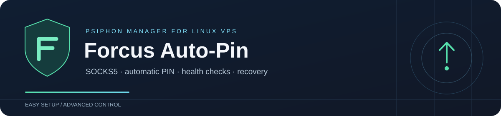
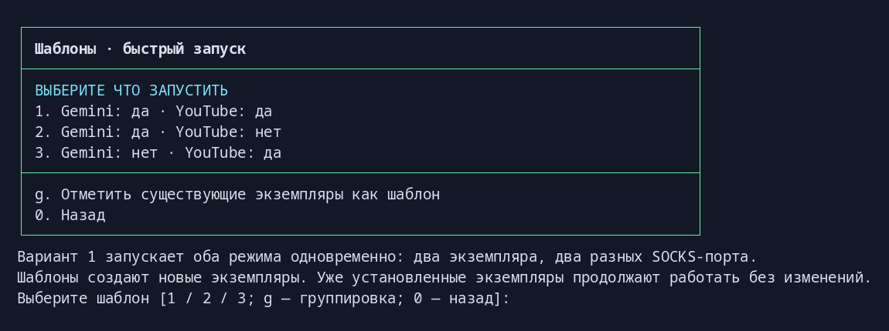

<div align="center">



# Forcus Auto-Pin

**Local SOCKS5 · automatic server PIN · Google/Gemini checks · recovery**


[](LICENSE)

**English** · [فارسی](README.fa_IR.md) · [العربية](README.ar_EG.md) · [中文](README.zh_CN.md) · [Español](README.es_ES.md) · [Русский](README.ru_RU.md) · [Türkçe](README.tr_TR.md)

</div>

A Psiphon manager for Linux VPS servers. Install it, choose Easy or Advanced, and manage independent proxy instances from the console. Xray can use the same SOCKS5 endpoint through generated outbound JSON.

[Quick Start](#quick-start) · [Features](#features) · [Console Menu](#menu) · [Command Reference](#commands) · [Xray Integration](#xray) · [Update & Operations](#operations) · [Uninstall](#uninstall) · [FAQ](#faq)

[YouTube Mode](#youtube) · [Security](#security)

<a id="quick-start"></a>

## Quick Start

Run these commands as root in Bash. Supported: Ubuntu/Debian, x86_64, systemd, Internet access and curl. The installer adds missing Docker/Go dependencies and preserves existing installations.

The exporter needs Go 1.22; an installed Go 1.21+ can select a checksum-verified newer toolchain. Older Go is refused before stopping services, without replacing the existing installation.

Download and run the installer. With no arguments in a terminal, it opens the setup menu:

```bash
curl -fsSL https://raw.githubusercontent.com/Forcus356/Psiphon-Auto-Pin-Manager/main/install_psiphon_autopin.sh -o /tmp/install_psiphon_autopin.sh && bash /tmp/install_psiphon_autopin.sh
```

After installation, reopen the menu at any time:

```bash
auto-pin
```

**SOCKS5:** `127.0.0.1:40000` → `1080`  ·  **HTTP:** `127.0.0.1:40001` → `8080`

These guides are available in seven languages. The console menu currently uses Russian labels; CLI flags are the same in every guide.

<a id="features"></a>

## Features

- Automatic first PIN: creates its own cache, reconnects to the selected server and verifies the connection before marking it pinned.
- One tunnel for a verified server PIN, or a pool of 2–32 tunnels with sampled checks.
- Up to 99 independent instances with separate ports, files, datastores, locks and services.
- Country pools, denied Google countries and optional strict country matching.
- Optional Gemini availability checks and a browser TLS profile for CAPTCHA detection.
- Speed thresholds with consecutive-sample confirmation and automatic connection recovery.
- Local SOCKS5, optional HTTP, private IPv4 binding and Xray outbound JSON.
- Dependency-aware uninstall that preserves preexisting Docker/Go and other consumers.

<a id="menu"></a>

## Console Menu

**All-instance overview (4.4):** the main menu displays every installed instance at once. **Templates** contains instances with saved template provenance; **Your instances** contains the rest. Each block has its own Gemini / YouTube / Psiphon role, number, ports, services, autostart, country, PIN, observations, speed, watchdog and version. Unrelated disabled modes are hidden in this overview. Press `r` to refresh all blocks; item 4 selects the instance to edit without hiding the others.

A current YouTube RU/PIN result is not marked searching just because the ordinary state.json is absent. Previous Gemini results are labeled as previous after a restart; current checking/search progress is separate. INCONCLUSIVE is not SERVING. Searching for RU may take time and is not reported complete before verification.

With multiple instances, **status, logs, Xray JSON and saved configuration** first ask for a number or **a — all**. Every output is labeled. Operations item **15** shows saved policy and connection settings without secret TargetServerEntry data. Connection and speed checks also offer selection. Main-menu update item 5 offers one or all instances, sequentially with confirmation per instance and accurate partial-failure reporting.

New templates save provenance automatically. Versions before 4.4 did not record it, so old instances initially appear under Your instances. Use **t → g**, enter existing numbers such as `1,2`, and confirm to mark an old pair as a template. Only grouping metadata changes; policy and services remain unchanged. Role names always follow current settings.

Interactive read commands without an explicit --instance also ask for the scope. Noninteractive automation retains its old instance default. Use --instance N for one without a prompt, or --all for explicit aggregation. --all supports status, logs, config and xray only; it cannot delete or stop instances.

```bash
psiphon-autopin status --all
psiphon-autopin logs 50 --all
psiphon-autopin config --all
psiphon-autopin xray --all
psiphon-autopin status --instance 2
```

**Gemini CAPTCHA:** a redirect to Google's `/sorry/` page is recognized with both standard curl and the optional browser TLS profile. It is no longer mislabeled as missing session fields (`INCONCLUSIVE`). The monitor confirms the CAPTCHA response before searching another exit. Other genuinely inconclusive replies keep their existing policy; a verified PIN alone does not prove Gemini is serving.

**Templates — quick setup:** choose **t** at the top of the main menu. On a clean VPS, Enter opens templates too. The three choices are **1 — Gemini: yes / YouTube: yes**, **2 — Gemini: yes / YouTube: no**, **3 — Gemini: no / YouTube: yes**.

To install both immediately: **Enter → 1 → y → y**. The wizard previews two independent instances with separate SOCKS/HTTP ports. When the standard ports are free, Gemini uses `127.0.0.1:40000` and YouTube uses `127.0.0.1:40002`; YouTube requests AUTO, requires Google RU, and starts with a 1500 KiB/s floor. Edit country, ports, watchdog and connection output before confirming; YouTube also exposes its speed floor. One common confirmation installs both in sequence; their monitors then run simultaneously. The main menu returns; item **4** changes the displayed instance without stopping the others.

Templates create **new** instances and preserve installed ones. Use Easy / Advanced to edit an existing instance. If the second installation fails, the first is kept and the partial result is reported explicitly. Started services do not mean the exit IP or PIN has been verified.

Boolean prompts explain **1 — enable, 0 — disable, Enter — keep the current value**. They also accept да/нет and y/n. For installation confirmation, y or 1 means yes, n or 0 means no, and Enter cancels.

After an interactive installation or apply, the selected instance’s main auto-pin menu opens automatically. If the IP check/search is still pending, it says so; a started service is not presented as a verified exit. Press **r** to refresh the displayed saved result. This does not launch a new network probe. Noninteractive automation exits normally.

**Easy:** country, connection output, Gemini, SOCKS port and watchdog minutes. **Advanced:** all installer settings. Main-menu items 3 and 4 provide operations and instance selection.

Easy item **6** and Advanced offer **YouTube Mode**. Easy item 5 remains the watchdog interval. If Gemini is enabled, the wizard offers a new independent instance with free ports. It does not apply changes to the original instance. Explicitly replacing its mode requires confirmation.

Easy adds item **7** for the video speed floor when YouTube is enabled.

Enter keeps a value; `-` clears a country list. Latin `y` reviews/applies settings, followed by `y/n` confirmation. Cancel keeps saved settings unchanged. Applying may reconnect the selected tunnel. Easy preserves hidden Advanced values.

The footer shows saved monitor results; opening the menu does not perform a fresh network check. Use `check` for that. `NO_COLOR=1 auto-pin` disables color; `TERM=dumb auto-pin` uses ASCII borders.

<details>
<summary>Menu preview</summary>

Illustrative output from the current menu renderer; the addresses and status below are demonstration data.




[Templates (.txt)](docs/assets/templates-demo.txt)

[Easy Mode (.txt)](docs/assets/easy-mode-demo.txt)

[Menu preview (.txt)](docs/assets/menu-demo.txt)

</details>

<a id="examples"></a>

## Installation Examples

Each example downloads and runs the installer without the menu. Explicit flags override saved values; omitted settings are retained on updates.

<details>
<summary>Installation Examples</summary>

### Without Gemini

```bash
bash <(curl -fsSL https://raw.githubusercontent.com/Forcus356/Psiphon-Auto-Pin-Manager/main/install_psiphon_autopin.sh) --region NL --no-gemini-check
```

### Country pool and speed floor

```bash
bash <(curl -fsSL https://raw.githubusercontent.com/Forcus356/Psiphon-Auto-Pin-Manager/main/install_psiphon_autopin.sh) --region NL,DE,PL --min-speed 1000
```

### Second independent instance

```bash
bash <(curl -fsSL https://raw.githubusercontent.com/Forcus356/Psiphon-Auto-Pin-Manager/main/install_psiphon_autopin.sh) --instance 2 --region DE --port 40002
```

### Publish SOCKS5 only

```bash
bash <(curl -fsSL https://raw.githubusercontent.com/Forcus356/Psiphon-Auto-Pin-Manager/main/install_psiphon_autopin.sh) --region NL --no-http
```

### Generate an Xray connection file

```bash
bash <(curl -fsSL https://raw.githubusercontent.com/Forcus356/Psiphon-Auto-Pin-Manager/main/install_psiphon_autopin.sh) --region NL --connection xray
```

### Three tunnels and a 10-minute watchdog

```bash
bash <(curl -fsSL https://raw.githubusercontent.com/Forcus356/Psiphon-Auto-Pin-Manager/main/install_psiphon_autopin.sh) --region NL --tunnel-pool 3 --interval 600
```

### Gemini with a browser TLS profile

```bash
bash <(curl -fsSL https://raw.githubusercontent.com/Forcus356/Psiphon-Auto-Pin-Manager/main/install_psiphon_autopin.sh) --region NL --gemini-check --impersonate
```

</details>

<a id="commands"></a>

## Command Reference

| Command | Purpose |
| --- | --- |
| `psiphon-autopin xray-routing --youtube-instance 2 --gemini-instance 1` | Export routing for the saved ports. |
| `psiphon-autopin update` | Update from auto-pin. |
| `auto-pin` | Open the setup/operations menu. |
| `auto-pin --instance 2` | Open the menu for instance 2. |
| `psiphon-autopin config` | Show saved user policy and connection settings without server credentials. |
| `psiphon-autopin status` | Show saved configuration and last result. |
| `psiphon-autopin check` | Run a fresh connection/policy check. |
| `psiphon-autopin rotate` | Request server rotation. |
| `psiphon-autopin region NL` | Switch to NL and clear the old country pool. |
| `psiphon-autopin pool NL,DE,PL` | Set a fallback country pool. |
| `psiphon-autopin pool ''` | Clear the country pool. |
| `psiphon-autopin speed` | Measure throughput through Psiphon. |
| `psiphon-autopin logs 100` | Show recent monitor and tunnel logs. |
| `psiphon-autopin start` | Start the selected instance. |
| `psiphon-autopin stop` | Stop the selected instance. |
| `psiphon-autopin restart` | Restart the selected instance. |
| `psiphon-autopin xray` | Print SOCKS outbound JSON for Xray. |
| `psiphon-autopin-2 status --instance 2` | Show instance 2 status. |
| `psiphon-autopin menu` | Open the menu through the original CLI. |
| `vps-psiphon status` | Compatibility alias for the same manager. |
| `psiphon-autopin refresh-cache --allow-interruption` | Refresh the datastore cache; interrupts the tunnel. |
| `psiphon-autopin prepare-pin` | Stage a PIN for a future restart. |
| `psiphon-autopin search` | Search for a suitable server. |
| `psiphon-autopin monitor` | Internal monitor entry point; normally started by systemd. |

`set-region --region NL` and `set-pool --region-pool NL,DE` are the long-form aliases of `region NL` and `pool NL,DE`. Runtime flags can override policy for a command; use the menu/installer to persist the full service configuration.

```bash
psiphon-autopin set-region --region NL
psiphon-autopin set-pool --region-pool NL,DE
```

`check` exit codes: **0** accepted observation, **2** policy rejection (including low speed), **1** probe/runtime error. An accepted observation can still have Gemini `INCONCLUSIVE`.

<a id="youtube"></a>

## YouTube Mode

Optional and **off by default**. Accepts only **Google GeoIP = RU**, read from the YouTube page through this instance’s SOCKS5h. It verifies the server PIN, not the absence of advertisements.

YouTube requires one tunnel and loopback. Gemini must be disabled on that instance. The requested Psiphon country can be AUTO or a chosen country; it is not automatically changed to RU. The mode overrides the ordinary deny/strict country acceptance with mandatory Google RU, while retaining those saved settings. UNKNOWN is retried and never accepted. Candidate delays, speed thresholds, cache, reserve candidates and PIN verification remain in use.

New YouTube instances default to **1500 KiB/s ≈ 12.3 Mbps**. Existing saved or explicit speeds are retained. **4 MiB is the probe size**, not the speed floor. Easy item **7** appears when YouTube is enabled and edits the video speed floor; Advanced and --min-speed remain available. A short probe is not a guarantee of sustained video quality.

Example for a clean VPS: Gemini on instance 1 (40000), YouTube on instance 2 (40002). For an existing installation choose unused instance numbers and ports; keep your working Gemini settings. The Gemini command below is for initial setup.

```bash
curl -fsSL https://raw.githubusercontent.com/Forcus356/Psiphon-Auto-Pin-Manager/main/install_psiphon_autopin.sh -o /tmp/install_psiphon_autopin.sh
```

### Gemini instance

```bash
bash /tmp/install_psiphon_autopin.sh --instance 1 --region NL --gemini-check --no-youtube-mode
```

### YouTube instance

```bash
bash /tmp/install_psiphon_autopin.sh --instance 2 --region AUTO --youtube-mode --no-gemini-check --tunnel-pool 1
```

Disable using the menu or rerun the installer with --instance 2 --no-youtube-mode. Other instances and the current Gemini setting remain unchanged. Older settings without youtube_mode mean false. Pools of 2–32 remain supported with YouTube disabled.

Status includes the observed IP, Google region, diagnostic ID, speed, PIN flag and last successful RU check. Rebooted, restarted or stale observations need fresh verification.

| Status | Purpose |
| --- | --- |
| `DISABLED` | Mode is off. |
| `SEARCHING` | Searching for Google RU. |
| `RU VERIFIED` | RU observed; a verified PIN is not yet confirmed. |
| `PIN VERIFIED` | RU and the selected server PIN were verified. |
| `DEGRADED` | Connection or throughput problem. |
| `UNKNOWN` | No reliable current GeoIP result. |

### Export routing for the saved ports

```bash
psiphon-autopin xray-routing --youtube-instance 2 --gemini-instance 1
```

Merge exported outbounds **after your existing default outbound** and put the domain rules before broad catch-all rules. Enable sniffing on the real traffic-receiving inbounds, or send destination domains through SOCKS/VLESS. Use host networking for Xray in Docker. These TCP proxies do not carry QUIC; the example blocks UDP/443 only for the selected service domains so clients can fall back to TCP. Encrypted/hidden names cannot always be identified. No Xray configuration is edited automatically.

[JSON + sniffing](docs/xray/README.md)

<a id="xray"></a>

## Xray Integration

The path is **Xray → SOCKS5 → Psiphon → Internet**. `xray` prints an outbound; `--connection xray` also saves `xray-outbound.json`. Add the outbound and routing to your Xray configuration yourself. It is the same SOCKS5 endpoint, not a separate transport.

```bash
psiphon-autopin xray
```

```json
{
  "tag": "psiphon-out",
  "protocol": "socks",
  "settings": {
    "servers": [{"address": "127.0.0.1", "port": 40000}]
  }
}
```

For Xray in a Docker bridge network, 127.0.0.1 refers to the Xray container. Use host networking or an existing private IPv4 of the VPS via `--bind`. Public binding is rejected. The proxy is intended for TCP.

<a id="options"></a>

## Installer Options

The menu edits watchdog timing in minutes. CLI `--interval` and JSON `interval` always use seconds. Port/region examples are values to replace with your own.

New installations with `auto` use `vps-psiphon`; existing recognized backends are preserved. `console` requires loopback binding. Setting `--no-gemini-check` leaves country, speed and recovery checks enabled.

<details>
<summary>Installer Options</summary>

| Flag | Default | Purpose |
| --- | --- | --- |
| `--youtube-mode` / `--no-youtube-mode` | off | Require Google RU and a single-tunnel verified PIN; conflicts with Gemini on the same instance. |
| `--region NL / --region AUTO / --region NL,DE` | menu / required for unattended install (NL) | Two-letter Psiphon country, AUTO, or a comma-separated country pool. |
| `--instance N` | 1 | Select instance 1–99. |
| `--port N` | 40000 + 2 × (N−1) | SOCKS port 1024–65534; HTTP uses the next port. |
| `--connection socks5\|xray` | socks5 | Persist SOCKS5 address or Xray JSON output. |
| `--menu / --interactive` | TTY / 0 args | Explicitly open the wizard; optional --instance N. |
| `--menu-mode easy\|advanced` | easy | Remember Easy or Advanced mode. |
| `--region-pool NL,DE` | empty | Fallback country list. |
| `--bind ADDR` | 127.0.0.1 | Bind to loopback or an existing private IPv4. |
| `--bind-loopback` | 127.0.0.1 | Restore binding to 127.0.0.1. |
| `--http / --no-http` | on | Enable/disable HTTP publication. |
| `--gemini-check / --no-gemini-check` | on | Enable/disable the Gemini probe. |
| `--impersonate / --no-impersonate` | off | Enable/disable browser TLS for Gemini page checks. |
| `--strict-region / --no-strict-region` | off | Enable/disable strict Google-country matching. |
| `--interval N` | 300 s | Normal check interval in seconds; minimum 60. |
| `--wait N` | 75 s | Readiness deadline in seconds; minimum 20. |
| `--delay N` | 12 s | Search-attempt delay in seconds; minimum 2. |
| `--min-speed N` | 800 / 1500 (YouTube) KiB/s | KiB/s floor; 0 disables speed-based rotation. |
| `--probe-mb N` | 4 MiB | Probe size 0–10 MiB; at 0 an enabled floor measures a page. |
| `--slow-threshold N` | 2 | Consecutive slow samples before rotation, 2–20. |
| `--fail-threshold N` | 3 | Consecutive failures before recovery, 2–20. |
| `--deny-regions 'RU BY IR SY CU KP CN VE'` | RU BY IR SY CU KP CN VE | Denied Google countries; an empty string clears the list. |
| `--tunnel-pool N` | 1 | 1 enables PIN; 2–32 uses a pool without one fixed PIN. |
| `--backend auto\|console\|vps-psiphon` | auto | Preserve/detect an existing backend, or choose one explicitly. |
| `--help` | — | Print installer help. |

</details>

<a id="operations"></a>

## Update & Operations

### Update from auto-pin

Main-menu item **5 — Update Auto-Pin (GitHub)** first offers one instance or **a — all**. Each instance retains its saved settings. Updates run sequentially with confirmation per instance and exact partial-success reporting. The updater resolves main to one commit, verifies the Git blob and Bash syntax, and shows version, commit and SHA-256. Network/verification failures do not run the installer; downgrades are refused. Successful updates reopen the new main menu.

These shortcuts open the same confirmed update action. The menu updater becomes available after this release is first installed; publish all release files to your repository before using it.

```bash
auto-pin --update
psiphon-autopin update
psiphon-autopin-2 update
```

Menu/source version selection always prefers the newest installed UI, so an old first instance does not hide the new features.

### Update an existing instance

Download the latest installer again and apply it to the instance. Existing settings are retained unless flags override them. Opening auto-pin alone does not download a new version.

```bash
curl -fsSL https://raw.githubusercontent.com/Forcus356/Psiphon-Auto-Pin-Manager/main/install_psiphon_autopin.sh -o /tmp/install_psiphon_autopin.sh && bash /tmp/install_psiphon_autopin.sh --instance 1
```

### Diagnostics

Check saved state, follow monitor-only logs, and test both configured proxies:

```bash
psiphon-autopin status
journalctl -u psiphon-autopin.service -n 100 --no-pager
journalctl -u psiphon-autopin.service -f
systemctl status vps-psiphon.service psiphon-autopin.service --no-pager
```

```bash
curl -4 -fsS --noproxy '' --proxy socks5h://127.0.0.1:40000 https://api.ipify.org
```

```bash
curl -4 -fsS --noproxy '' --proxy http://127.0.0.1:40001 https://api.ipify.org
```

Connectivity, IP, country, Gemini and speed checks use SOCKS with remote DNS and no direct fallback. Installer downloads can use the VPS connection. WARP is not removed automatically.

### Independent instances

Use psiphon-autopin-N or auto-pin --instance N. Default host ports are shown below; --port can override them. The 99-instance and 32-tunnel limits are configuration bounds, not a capacity guarantee for your VPS.

| # | SOCKS5 | HTTP | CLI |
| --- | --- | --- | --- |
| 1 | `40000` | `40001` | `psiphon-autopin` |
| 2 | `40002` | `40003` | `psiphon-autopin-2` |
| 3 | `40004` | `40005` | `psiphon-autopin-3` |

### Watchdog and traffic

Easy item 5 and Advanced edit the built-in monitor interval in minutes: minimum 1, default 5. Fractional minutes such as 1.5 are accepted when they represent whole seconds. Failure retries may happen sooner. There is no second Chara watchdog.

Default policy: Gemini on, one tunnel, 800 KiB/s floor, two slow samples, a 4 MiB probe and three failures before recovery. A 4 MiB probe every five minutes uses about 34 GiB per 30 days before search traffic. --min-speed 0 disables speed rotation; --probe-mb 0 alone can still measure a page.

<a id="uninstall"></a>

## Uninstall

Remove the selected instance while keeping Docker/Go:

```bash
psiphon-autopin uninstall
```

Remove the instance and eligible Docker/Go packages installed by this manager:

```bash
psiphon-autopin uninstall --purge-deps
```

```bash
psiphon-autopin-2 uninstall --purge-deps
```

Ownership is recorded per component from version 4.2. Preexisting or unknown-origin packages remain installed. Other Auto-Pin instances retain shared dependencies; other running/stopped containers or unknown Docker usage retain Docker. APT simulation blocks removal of unrelated packages.

Legacy installations without an ownership receipt keep dependencies. No autoremove or arbitrary Docker-data deletion is used. Python, curl, GCC and migration backups remain. Menu items 13 and 14 provide the two removal modes.

Plain uninstall releases the ownership receipt after removing the last instance and leaves dependencies installed. Choose `--purge-deps` during removal if you want eligible owned dependencies removed.

If APT cleanup fails, the command reports failure and retains its receipt. After fixing APT, retry from the downloaded project directory:

```bash
python3 autopin_system.py cleanup --purge
```

<a id="faq"></a>

## FAQ

<details>
<summary>How do I know the PIN is verified?</summary>

Look for INITIAL PIN VERIFIED and adopted_unpinned: false. pin_prepared: true means staged, not yet verified. First PIN creation makes a controlled reconnect; failed verification rolls back and retries on a later health cycle.

</details>

<details>
<summary>Does INCONCLUSIVE mean Gemini works?</summary>

No model reply was confirmed. SERVING is an anonymous successful probe; INCONCLUSIVE is unresolved and does not trigger rotation by itself. The current policy can verify a server PIN while Gemini stays inconclusive. Your logged-in browser account is not tested.

</details>

<details>
<summary>Why do ip and server_ip differ?</summary>

ip is the public proxy exit; server_ip is the Psiphon server address. A pinned server can also change its public exit after reconnecting, so an unchanged IP is not guaranteed.

</details>

<details>
<summary>Why does y sometimes ask again?</summary>

Malformed UTF-8 input is rejected instead of applying corrupted input or closing the menu. Retype a Latin y; confirm with y/n.

</details>

<details>
<summary>Why is the requested country different from Google?</summary>

Psiphon EgressRegion is a requested region. Google can classify the exit differently. The deny list and optional strict-region setting control acceptance. No country or service access is guaranteed.

</details>

<a id="files"></a>

## Files & Configuration

Paths below are for instance 1. Other instances add -N to instance app/data/config directories; the ownership receipt and backup directory are shared. Connection and server-entry files contain private configuration data.

| Path | Purpose |
| --- | --- |
| `/var/lib/psiphon-autopin/youtube-status.json` | Latest YouTube observation and freshness metadata. |
| `/var/lib/psiphon-autopin/update-source.json` | Commit and source checksum of the last successful menu update. |
| `/var/lib/psiphon-autopin/settings.json` | Effective settings and menu preferences. |
| `/var/lib/psiphon-autopin/state.json` | Last monitoring result and PIN state. |
| `/opt/vps-psiphon/config/psiphon.config` | Private Psiphon configuration and target entry. |
| `/var/lib/psiphon-autopin/server-entry-cache.json` | Private server-entry cache. |
| `/var/lib/psiphon-autopin/connection.json` | Selected connection output. |
| `/var/lib/psiphon-autopin/xray-outbound.json` | Xray outbound, when that format is selected. |
| `/var/lib/psiphon-autopin-system/dependencies.json` | Docker/Go ownership receipt, mode 0600. |
| `/var/backups/psiphon-autopin` | Migration and recovery backups. |

<a id="security"></a>

## Security

Third-party Psiphon and Debian images are pinned by digest. ConsoleClient is downloaded from a fixed commit and checked against SHA-256 before use, including upgrades. Containers use UID 1000, no capabilities, a read-only root filesystem and no-new-privileges. Root host services have systemd filesystem/capability restrictions; the Docker controller still requires root-equivalent privileges. Explicit private --bind remains available outside YouTube mode. See the security notes for the trust boundary and artifact references.

[SECURITY.md](SECURITY.md) · [SECURITY.ru_RU.md](SECURITY.ru_RU.md)

<a id="development"></a>

## Development & Credits

From a local project checkout:

```bash
python3 -m unittest discover -s tests -v
bash -n install_psiphon_autopin.sh
```

[CHANGELOG](CHANGELOG.md) · [tests](tests)

Built with: [Psiphon Tunnel Core](https://github.com/Psiphon-Labs/psiphon-tunnel-core), [psiphon-docker](https://github.com/swarupsengupta2007/psiphon-docker), [bbolt](https://github.com/etcd-io/bbolt), [curl-impersonate](https://github.com/lexiforest/curl-impersonate).

License: [GPL-3.0](LICENSE). Operational ideas were studied in [Chara vps-psiphon](https://github.com/Chara-Freedom/vps-psiphon); its installer and watchdog are not part of our runtime. README organization is inspired by [3x-ui](https://github.com/MHSanaei/3x-ui).
