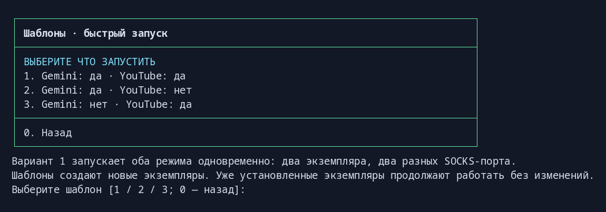

<div align="center">


# Forcus Auto-Pin

**Локальный SOCKS5 · автоматический PIN · Google/Gemini · восстановление**


[](LICENSE)

[English](README.md) · [فارسی](README.fa_IR.md) · [العربية](README.ar_EG.md) · [中文](README.zh_CN.md) · [Español](README.es_ES.md) · **Русский** · [Türkçe](README.tr_TR.md)

</div>

Менеджер Psiphon для Linux VPS. Установите, выберите Easy или Advanced и управляйте независимыми экземплярами из консоли. Xray подключается к тому же SOCKS5 через готовый outbound JSON.

[Быстрый старт](#quick-start) · [Возможности](#features) · [Консольное меню](#menu) · [Все команды](#commands) · [Подключение Xray](#xray) · [Обновление и обслуживание](#operations) · [Удаление](#uninstall) · [Частые вопросы](#faq)

[YouTube Mode](#youtube) · [Безопасность](#security)

<a id="quick-start"></a>

## Быстрый старт

Выполняйте команды от root в Bash. Поддерживаются Ubuntu/Debian, x86_64, systemd; нужны Интернет и curl. Установщик добавляет недостающие Docker/Go и сохраняет существующие установки.

Для экспортёра нужен Go 1.22; установленный Go 1.21+ может выбрать более новый toolchain с проверкой checksum. Более старый Go отклоняется до остановки служб, без замены существующей установки.

Скачайте и запустите установщик. Без аргументов в терминале откроется меню:

```bash
curl -fsSL https://raw.githubusercontent.com/Forcus356/Psiphon-Auto-Pin-Manager/main/install_psiphon_autopin.sh -o /tmp/install_psiphon_autopin.sh && bash /tmp/install_psiphon_autopin.sh
```

После установки меню можно открыть в любой момент:

```bash
auto-pin
```

**SOCKS5:** `127.0.0.1:40000` → `1080`  ·  **HTTP:** `127.0.0.1:40001` → `8080`

Инструкции доступны на семи языках. Консольное меню сейчас русскоязычное; команды и флаги одинаковы во всех инструкциях.

<a id="features"></a>

## Возможности

- Первый автоматический PIN: создание кэша, подключение к выбранному серверу и проверка перед подтверждением закрепления.
- Один туннель с PIN или пул из 2–32 туннелей с выборочными проверками.
- До 99 независимых экземпляров с отдельными портами, файлами, базами, блокировками и службами.
- Пулы стран, запрещённые страны Google и необязательное строгое совпадение региона.
- Необязательные проверки Gemini и TLS-профиль браузера для обнаружения CAPTCHA.
- Порог скорости с подтверждением несколькими измерениями и автоматическое восстановление соединения.
- Локальный SOCKS5, необязательный HTTP, частный IPv4 и Xray outbound JSON.
- Удаление с учётом происхождения Docker/Go и сохранением чужих потребителей.

<a id="menu"></a>

## Консольное меню

**Gemini CAPTCHA:** перенаправление на страницу Google `/sorry/` распознаётся и с обычным curl, и с дополнительным TLS-профилем браузера. Оно больше не записывается как отсутствие полей сессии (`INCONCLUSIVE`). Монитор подтверждает CAPTCHA повторной проверкой и затем ищет другой выход. Остальные неопределённые ответы сохраняют прежнюю политику; проверенный PIN сам по себе не подтверждает работу Gemini.

**Шаблоны — быстрый запуск:** верхний пункт **t** главного меню. На чистой VPS он также открывается по Enter. Доступны три варианта: **1 — Gemini: да / YouTube: да**, **2 — Gemini: да / YouTube: нет**, **3 — Gemini: нет / YouTube: да**.

Чтобы сразу установить оба режима: **Enter → 1 → y → y**. Перед подтверждением мастер показывает два экземпляра с разными SOCKS/HTTP-портами. При свободных стандартных портах это Gemini `127.0.0.1:40000` и YouTube `127.0.0.1:40002`; регион YouTube — AUTO, обязательная страна Google — RU, порог — 1500 KiB/s. Можно изменить регион, порты, watchdog и формат подключения, у YouTube также порог скорости. После одного общего подтверждения установщик последовательно запускает оба экземпляра, затем они работают одновременно. Главное меню открывается снова; пункт **4** переключает отображаемый экземпляр, не останавливая остальные.

Шаблоны создают **новые** экземпляры и сохраняют уже установленные. Для изменения работающего экземпляра используйте Easy / Advanced. Если установка второго не удалась, первый сохраняется, а меню явно сообщает о частичном результате. Запуск служб не означает, что IP уже найден или PIN проверен.

Во всех переключателях подсказка указывает: **1 — включить, 0 — выключить, Enter — оставить текущее значение**. Также принимаются да/нет и y/n. При подтверждении установки y или 1 означает «да», n или 0 — «нет», Enter отменяет действие.

После интерактивной установки или применения настроек главное меню auto-pin выбранного экземпляра открывается автоматически. Пока проверка или поиск IP не завершены, это явно указано: запущенная служба не означает проверенный выход. Нажмите **r**, чтобы обновить отображаемый сохранённый результат. Это не запускает новую сетевую проверку. Неинтерактивные команды завершаются как обычно.

**Easy:** регион, формат подключения, Gemini, SOCKS-порт и watchdog в минутах. **Advanced:** все параметры установщика. Пункты 3 и 4 главного меню — управление и выбор экземпляра.

В Easy это пункт **6**, в Advanced — переключатель **YouTube Mode**. Watchdog остаётся пунктом 5 Easy. Если Gemini включён, меню предложит отдельный экземпляр со свободными портами. Исходный экземпляр не изменится. Замена его режима требует явного выбора и подтверждения.

При включённом YouTube в Easy появляется пункт **7** — порог скорости для видео.

Enter оставляет значение, `-` очищает список стран. Латинская `y` показывает итог и применяет настройки после подтверждения `y/n`. Отмена сохраняет прежнюю конфигурацию. Применение может переподключить выбранный туннель. Easy сохраняет скрытые параметры Advanced.

Подвал показывает сохранённые результаты монитора: открытие меню не запускает новую сетевую проверку. Для неё есть `check`. `NO_COLOR=1 auto-pin` отключает цвет, `TERM=dumb auto-pin` включает рамку ASCII.

<details>
<summary>Предпросмотр меню</summary>

Пример вывода текущего меню. Адреса и состояния на изображении — демонстрационные.




[Templates (.txt)](docs/assets/templates-demo.txt)

[Easy Mode (.txt)](docs/assets/easy-mode-demo.txt)

[Предпросмотр меню (.txt)](docs/assets/menu-demo.txt)

</details>

<a id="examples"></a>

## Примеры установки

Каждый пример скачивает и запускает установщик без меню. Явные флаги заменяют сохранённые значения, остальные параметры при обновлении сохраняются.

<details>
<summary>Примеры установки</summary>

### Без проверки Gemini

```bash
bash <(curl -fsSL https://raw.githubusercontent.com/Forcus356/Psiphon-Auto-Pin-Manager/main/install_psiphon_autopin.sh) --region NL --no-gemini-check
```

### Пул стран и порог скорости

```bash
bash <(curl -fsSL https://raw.githubusercontent.com/Forcus356/Psiphon-Auto-Pin-Manager/main/install_psiphon_autopin.sh) --region NL,DE,PL --min-speed 1000
```

### Второй независимый экземпляр

```bash
bash <(curl -fsSL https://raw.githubusercontent.com/Forcus356/Psiphon-Auto-Pin-Manager/main/install_psiphon_autopin.sh) --instance 2 --region DE --port 40002
```

### Публиковать только SOCKS5

```bash
bash <(curl -fsSL https://raw.githubusercontent.com/Forcus356/Psiphon-Auto-Pin-Manager/main/install_psiphon_autopin.sh) --region NL --no-http
```

### Создать файл подключения Xray

```bash
bash <(curl -fsSL https://raw.githubusercontent.com/Forcus356/Psiphon-Auto-Pin-Manager/main/install_psiphon_autopin.sh) --region NL --connection xray
```

### Три туннеля и watchdog 10 минут

```bash
bash <(curl -fsSL https://raw.githubusercontent.com/Forcus356/Psiphon-Auto-Pin-Manager/main/install_psiphon_autopin.sh) --region NL --tunnel-pool 3 --interval 600
```

### Gemini с TLS-профилем браузера

```bash
bash <(curl -fsSL https://raw.githubusercontent.com/Forcus356/Psiphon-Auto-Pin-Manager/main/install_psiphon_autopin.sh) --region NL --gemini-check --impersonate
```

</details>

<a id="commands"></a>

## Все команды

| Команда | Назначение |
| --- | --- |
| `psiphon-autopin xray-routing --youtube-instance 2 --gemini-instance 1` | Экспорт маршрутов с сохранёнными портами. |
| `psiphon-autopin update` | Обновить через auto-pin. |
| `auto-pin` | Открыть меню настройки и управления. |
| `auto-pin --instance 2` | Открыть меню экземпляра 2. |
| `psiphon-autopin status` | Показать настройки и последний результат. |
| `psiphon-autopin check` | Выполнить новую проверку соединения и политик. |
| `psiphon-autopin rotate` | Запросить ротацию сервера. |
| `psiphon-autopin region NL` | Сменить страну на NL и очистить прежний пул. |
| `psiphon-autopin pool NL,DE,PL` | Задать пул стран для перебора. |
| `psiphon-autopin pool ''` | Очистить пул стран. |
| `psiphon-autopin speed` | Измерить скорость через Psiphon. |
| `psiphon-autopin logs 100` | Показать журналы монитора и туннеля. |
| `psiphon-autopin start` | Запустить выбранный экземпляр. |
| `psiphon-autopin stop` | Остановить выбранный экземпляр. |
| `psiphon-autopin restart` | Перезапустить выбранный экземпляр. |
| `psiphon-autopin xray` | Вывести SOCKS outbound JSON для Xray. |
| `psiphon-autopin-2 status` | Показать статус экземпляра 2. |
| `psiphon-autopin menu` | Открыть меню через основной CLI. |
| `vps-psiphon status` | Совместимый алиас того же менеджера. |
| `psiphon-autopin refresh-cache --allow-interruption` | Обновить кэш базы; соединение прерывается. |
| `psiphon-autopin prepare-pin` | Подготовить PIN к будущему перезапуску. |
| `psiphon-autopin search` | Найти подходящий сервер. |
| `psiphon-autopin monitor` | Внутренняя команда монитора; обычно запускается systemd. |

`set-region --region NL` и `set-pool --region-pool NL,DE` — полные формы `region NL` и `pool NL,DE`. Флаги CLI могут переопределять политику отдельной команды; для сохранения всей конфигурации службы используйте меню или установщик.

```bash
psiphon-autopin set-region --region NL
psiphon-autopin set-pool --region-pool NL,DE
```

Коды завершения `check`: **0** — результат принят, **2** — отклонён политикой, включая низкую скорость, **1** — ошибка проверки или выполнения. Принятый результат может содержать Gemini `INCONCLUSIVE`.

<a id="youtube"></a>

## YouTube Mode

Необязательный режим, **по умолчанию выключен**. Принимает только **Google GeoIP = RU**, полученный со страницы YouTube через SOCKS5h своего экземпляра. Проверяется регион и PIN сервера; отсутствие рекламы не проверяется.

Для YouTube нужны один туннель, loopback и выключенная проверка Gemini на этом экземпляре. Регион Psiphon может быть AUTO или выбранной страной; он не меняется автоматически на RU. Режим заменяет обычное условие deny/strict обязательной проверкой Google RU, сохраняя сами настройки для отключённого режима. UNKNOWN повторно проверяется и не принимается. Сохраняются задержки поиска, пороги скорости, кэш, резервные кандидаты и проверка PIN.

Новые YouTube-экземпляры по умолчанию используют **1500 KiB/s ≈ 12,3 Мбит/с**. Сохранённые и явно заданные значения не заменяются. **4 MiB — объём пробы**, а не порог скорости. При включённом YouTube в Easy появляется пункт **7** для порога скорости; Advanced и --min-speed тоже доступны. Короткая проба не гарантирует стабильность всего видеопотока.

Пример для чистого VPS: Gemini — экземпляр 1 (40000), YouTube — экземпляр 2 (40002). На установленном сервере выбирайте свободные номера и порты, сохраняя настройки рабочего Gemini. Команда Gemini ниже предназначена для первоначальной настройки.

```bash
curl -fsSL https://raw.githubusercontent.com/Forcus356/Psiphon-Auto-Pin-Manager/main/install_psiphon_autopin.sh -o /tmp/install_psiphon_autopin.sh
```

### Экземпляр Gemini

```bash
bash /tmp/install_psiphon_autopin.sh --instance 1 --region NL --gemini-check --no-youtube-mode
```

### Экземпляр YouTube

```bash
bash /tmp/install_psiphon_autopin.sh --instance 2 --region AUTO --youtube-mode --no-gemini-check --tunnel-pool 1
```

Отключайте через меню или повторный запуск установщика с --instance 2 --no-youtube-mode. Другие экземпляры и текущее значение проверки Gemini не меняются. Отсутствие youtube_mode в старом JSON означает false. Пулы из 2–32 туннелей сохраняются при выключенном YouTube.

В статусе есть наблюдаемый IP, регион Google, диагностический ID, скорость, признак PIN и время последней успешной проверки RU. После загрузки ОС, перезапуска контейнера или устаревания результата нужна новая проверка.

| Status | Назначение |
| --- | --- |
| `DISABLED` | Режим выключен. |
| `SEARCHING` | Идёт поиск Google RU. |
| `RU VERIFIED` | RU подтверждён; проверенный PIN пока не подтверждён. |
| `PIN VERIFIED` | Проверены RU и PIN выбранного сервера. |
| `DEGRADED` | Проблема соединения или скорости. |
| `UNKNOWN` | Нет достоверного текущего результата GeoIP. |

### Экспорт маршрутов с сохранёнными портами

```bash
psiphon-autopin xray-routing --youtube-instance 2 --gemini-instance 1
```

Добавьте экспортированные outbounds **после существующего outbound по умолчанию**, а доменные правила — перед общими перехватывающими правилами. Включите sniffing на реальных входящих подключениях Xray либо передавайте домены назначения через SOCKS/VLESS. Для Xray в Docker используйте host-сеть. Прокси TCP не переносит QUIC: пример блокирует UDP/443 только для указанных сервисных доменов, позволяя клиенту перейти на TCP. Зашифрованные или скрытые имена не всегда распознаются. Рабочая конфигурация Xray автоматически не изменяется.

[JSON + sniffing](docs/xray/README.md)

<a id="xray"></a>

## Подключение Xray

Цепочка: **Xray → SOCKS5 → Psiphon → Интернет**. Команда xray печатает outbound, а --connection xray дополнительно сохраняет xray-outbound.json. Добавьте outbound и маршрутизацию в Xray самостоятельно. Используется тот же SOCKS5, отдельный транспорт не создаётся.

```bash
psiphon-autopin xray
```

```json
{
  "tag": "psiphon-out",
  "protocol": "socks",
  "settings": {
    "servers": [{"address": "127.0.0.1", "port": 40000}]
  }
}
```

В Docker bridge адрес 127.0.0.1 указывает на сам контейнер Xray. Используйте host-сеть либо существующий частный IPv4 VPS через --bind. Публичная привязка запрещена. Прокси предназначен для TCP.

<a id="options"></a>

## Параметры установщика

В меню watchdog задаётся в минутах. Флаг --interval и поле interval в JSON всегда используют секунды. Значения портов и регионов в примерах можно заменить своими.

Новая установка с `auto` использует `vps-psiphon`; существующий распознанный backend сохраняется. Для `console` нужна привязка к loopback. При `--no-gemini-check` сохраняются проверки страны, скорости и восстановление.

<details>
<summary>Параметры установщика</summary>

| Флаг | По умолчанию | Назначение |
| --- | --- | --- |
| `--youtube-mode` / `--no-youtube-mode` | выключено | Обязательный Google RU и проверяемый PIN одного туннеля; несовместим с Gemini на том же экземпляре. |
| `--region NL / --region AUTO / --region NL,DE` | выбор в меню / обязателен без меню (NL) | Двухбуквенная страна Psiphon, AUTO или пул через запятую. |
| `--instance N` | 1 | Выбрать экземпляр 1–99. |
| `--port N` | 40000 + 2 × (N−1) | SOCKS-порт 1024–65534; HTTP использует следующий. |
| `--connection socks5\|xray` | socks5 | Сохранить вывод адреса SOCKS5 или Xray JSON. |
| `--menu / --interactive` | TTY / 0 args | Явно открыть мастер; можно добавить --instance N. |
| `--menu-mode easy\|advanced` | easy | Сохранить режим Easy или Advanced. |
| `--region-pool NL,DE` | пусто | Список стран для перебора. |
| `--bind ADDR` | 127.0.0.1 | Привязка к loopback или существующему частному IPv4. |
| `--bind-loopback` | 127.0.0.1 | Вернуть привязку к 127.0.0.1. |
| `--http / --no-http` | включено | Включить/выключить публикацию HTTP. |
| `--gemini-check / --no-gemini-check` | включено | Включить/выключить проверку Gemini. |
| `--impersonate / --no-impersonate` | выключено | Включить/выключить TLS-профиль браузера для страницы Gemini. |
| `--strict-region / --no-strict-region` | выключено | Включить/выключить строгое совпадение страны Google. |
| `--interval N` | 300 s | Обычный интервал в секундах, минимум 60. |
| `--wait N` | 75 s | Ожидание готовности в секундах, минимум 20. |
| `--delay N` | 12 s | Пауза между попытками поиска в секундах, минимум 2. |
| `--min-speed N` | 800 / 1500 (YouTube) KiB/s | Порог KiB/s; 0 отключает ротацию по скорости. |
| `--probe-mb N` | 4 MiB | Проба 0–10 MiB; при 0 и включённом пороге измеряется страница. |
| `--slow-threshold N` | 2 | Последовательные низкие измерения до ротации, 2–20. |
| `--fail-threshold N` | 3 | Последовательные ошибки до восстановления, 2–20. |
| `--deny-regions 'RU BY IR SY CU KP CN VE'` | RU BY IR SY CU KP CN VE | Запрещённые страны Google; пустая строка очищает список. |
| `--tunnel-pool N` | 1 | 1 — PIN; 2–32 — пул без единого закреплённого выхода. |
| `--backend auto\|console\|vps-psiphon` | auto | Сохранить/определить существующий backend или выбрать явно. |
| `--help` | — | Показать справку установщика. |

</details>

<a id="operations"></a>

## Обновление и обслуживание

### Обновить через auto-pin

Пункт **5 — Обновить Auto-Pin (GitHub)** обновляет выбранный установленный экземпляр, сохраняя его настройки. Другие экземпляры не меняются; для их обновления выберите нужный номер в пункте 4. Обновлятор фиксирует коммит main, проверяет Git blob и синтаксис Bash, показывает версию, коммит и SHA-256 и просит подтверждение. При ошибке сети или проверки установщик не запускается. Понижение версии запрещено. После успеха автоматически открывается обновлённое главное меню.

Эти команды открывают то же подтверждаемое действие. Обновление из меню появится после первой установки этой версии; сначала выложите все файлы релиза в свой репозиторий.

```bash
auto-pin --update
psiphon-autopin update
psiphon-autopin-2 update
```

Всегда выбирается самое новое установленное меню: старый первый экземпляр не скрывает новые возможности.

### Обновить существующий экземпляр

Снова скачайте актуальный установщик и примените к экземпляру. Прежние настройки сохраняются, если не указаны заменяющие флаги. Само открытие auto-pin новую версию не скачивает.

```bash
curl -fsSL https://raw.githubusercontent.com/Forcus356/Psiphon-Auto-Pin-Manager/main/install_psiphon_autopin.sh -o /tmp/install_psiphon_autopin.sh && bash /tmp/install_psiphon_autopin.sh --instance 1
```

### Диагностика

Посмотрите состояние, журнал только монитора и проверьте оба настроенных прокси:

```bash
psiphon-autopin status
journalctl -u psiphon-autopin.service -n 100 --no-pager
journalctl -u psiphon-autopin.service -f
systemctl status vps-psiphon.service psiphon-autopin.service --no-pager
```

```bash
curl -4 -fsS --noproxy '' --proxy socks5h://127.0.0.1:40000 https://api.ipify.org
```

```bash
curl -4 -fsS --noproxy '' --proxy http://127.0.0.1:40001 https://api.ipify.org
```

Проверки соединения, IP, страны, Gemini и скорости идут через SOCKS с удалённым DNS без прямого обходного подключения. Загрузки установщика могут идти через сеть VPS. WARP автоматически не удаляется.

### Независимые экземпляры

Используйте psiphon-autopin-N или auto-pin --instance N. Ниже — стандартные порты хоста; --port позволяет их изменить. Пределы 99 экземпляров и 32 туннеля — границы параметров, а не гарантия мощности VPS.

| # | SOCKS5 | HTTP | CLI |
| --- | --- | --- | --- |
| 1 | `40000` | `40001` | `psiphon-autopin` |
| 2 | `40002` | `40003` | `psiphon-autopin-2` |
| 3 | `40004` | `40005` | `psiphon-autopin-3` |

### Watchdog и трафик

Пункт 5 Easy и параметры Advanced задают период встроенного монитора в минутах: минимум 1, по умолчанию 5. Дробное значение 1,5 допустимо, если получается целое число секунд. После ошибок повторы могут быть чаще. Второй watchdog от Chara не запускается.

По умолчанию: Gemini включён, один туннель, порог 800 KiB/s, два низких измерения, проба 4 MiB и три ошибки до восстановления. Проба 4 MiB раз в пять минут расходует около 34 GiB за 30 дней без учёта поиска. --min-speed 0 отключает ротацию по скорости; один --probe-mb 0 может оставлять измерение страницы.

<a id="uninstall"></a>

## Удаление

Удалить выбранный экземпляр, сохранив Docker/Go:

```bash
psiphon-autopin uninstall
```

Удалить экземпляр и подходящие пакеты Docker/Go, установленные именно нашим менеджером:

```bash
psiphon-autopin uninstall --purge-deps
```

```bash
psiphon-autopin-2 uninstall --purge-deps
```

Происхождение каждого компонента учитывается с версии 4.2. Ранее установленные пакеты и пакеты неизвестного происхождения сохраняются. Другие экземпляры Auto-Pin сохраняют общие зависимости; чужие работающие/остановленные контейнеры или неизвестное использование Docker сохраняют Docker. Симуляция APT блокирует удаление посторонних пакетов.

Старые установки без журнала сохраняют зависимости. Autoremove и произвольное стирание Docker-данных не выполняются. Python, curl, GCC и резервные копии миграций остаются. В меню этим режимам соответствуют пункты 13 и 14.

Обычное удаление последнего экземпляра освобождает запись о владении и оставляет зависимости. Если нужны удаление экземпляра и очистка его зависимостей, выбирайте `--purge-deps` сразу.

Если APT не смог удалить пакеты, команда сообщает ошибку и сохраняет журнал. После исправления APT повторите проверку из папки скачанного проекта:

```bash
python3 autopin_system.py cleanup --purge
```

<a id="faq"></a>

## Частые вопросы

<details>
<summary>Как понять, что PIN подтверждён?</summary>

Ищите INITIAL PIN VERIFIED и adopted_unpinned: false. pin_prepared: true означает подготовку без подтверждения. Первый PIN требует контролируемого переподключения; неудачная проверка откатывается и повторяется в одном из следующих циклов.

</details>

<details>
<summary>INCONCLUSIVE означает, что Gemini работает?</summary>

Ответ модели не подтверждён. SERVING — успешная анонимная проба; INCONCLUSIVE — неопределённость, сама по себе не вызывающая ротацию. Текущая политика допускает проверенный PIN с неопределённым Gemini. Вход в ваш браузерный аккаунт не проверяется.

</details>

<details>
<summary>Почему ip и server_ip отличаются?</summary>

ip — публичный выход прокси, server_ip — адрес сервера Psiphon. После переподключения даже тот же сервер может дать другой выходной IP; неизменность IP не гарантируется.

</details>

<details>
<summary>Почему y иногда просит повторить ввод?</summary>

Повреждённый UTF-8 отклоняется, чтобы не применить некорректный ввод и не закрыть меню. Введите латинскую y повторно; подтверждение — y/n.

</details>

<details>
<summary>Почему выбранная страна отличается от Google?</summary>

EgressRegion — запрашиваемый регион Psiphon. Google может оценить выход иначе. Принятие определяют список запрещённых стран и strict-region. Страна и доступ к сервисам не гарантируются.

</details>

<a id="files"></a>

## Файлы и настройки

Ниже пути экземпляра 1. У остальных к каталогам программы, данных и конфигурации добавляется -N; запись о владении и каталог резервных копий общие. Файлы подключения и серверных записей содержат частные данные конфигурации.

| Путь | Назначение |
| --- | --- |
| `/var/lib/psiphon-autopin/youtube-status.json` | Последнее наблюдение YouTube и данные для проверки актуальности. |
| `/var/lib/psiphon-autopin/update-source.json` | Коммит и хеш исходника последнего успешного обновления из меню. |
| `/var/lib/psiphon-autopin/settings.json` | Действующие настройки и предпочтения меню. |
| `/var/lib/psiphon-autopin/state.json` | Последний результат мониторинга и состояние PIN. |
| `/opt/vps-psiphon/config/psiphon.config` | Приватная конфигурация Psiphon и целевая запись. |
| `/var/lib/psiphon-autopin/server-entry-cache.json` | Приватный кэш записей серверов. |
| `/var/lib/psiphon-autopin/connection.json` | Выбранный формат подключения. |
| `/var/lib/psiphon-autopin/xray-outbound.json` | Xray outbound, если выбран этот формат. |
| `/var/lib/psiphon-autopin-system/dependencies.json` | Журнал происхождения Docker/Go, права 0600. |
| `/var/backups/psiphon-autopin` | Резервные копии миграции и восстановления. |

<a id="security"></a>

## Безопасность

Образы Psiphon и Debian закреплены по digest. ConsoleClient скачивается из фиксированного коммита и проверяется по SHA-256 до использования, в том числе при обновлении. Контейнеры работают от UID 1000, без capabilities, с файловой системой только для чтения и no-new-privileges. Для root-служб настроены ограничения systemd; контроллер Docker по-прежнему требует прав, эквивалентных root. Явная частная привязка --bind сохранена вне YouTube Mode. Подробности границ доверия и ссылки на компоненты — в заметках о безопасности.

[SECURITY.md](SECURITY.md) · [SECURITY.ru_RU.md](SECURITY.ru_RU.md)

<a id="development"></a>

## Разработка и благодарности

Из локальной копии проекта:

```bash
python3 -m unittest discover -s tests -v
bash -n install_psiphon_autopin.sh
```

[CHANGELOG](CHANGELOG.md) · [tests](tests)

Используются: [Psiphon Tunnel Core](https://github.com/Psiphon-Labs/psiphon-tunnel-core), [psiphon-docker](https://github.com/swarupsengupta2007/psiphon-docker), [bbolt](https://github.com/etcd-io/bbolt), [curl-impersonate](https://github.com/lexiforest/curl-impersonate).

Лицензия [GPL-3.0](LICENSE). Эксплуатационные идеи изучены в [Chara vps-psiphon](https://github.com/Chara-Freedom/vps-psiphon); его установщик и watchdog не входят в нашу исполняемую цепочку. Структура README вдохновлена [3x-ui](https://github.com/MHSanaei/3x-ui).
