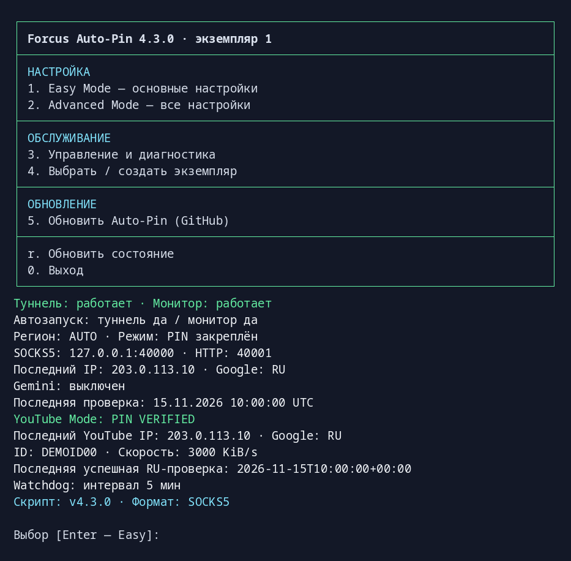

<div align="center">


# Forcus Auto-Pin

**Yerel SOCKS5 · otomatik PIN · Google/Gemini denetimi · kurtarma**


[](LICENSE)

[English](README.md) · [فارسی](README.fa_IR.md) · [العربية](README.ar_EG.md) · [中文](README.zh_CN.md) · [Español](README.es_ES.md) · [Русский](README.ru_RU.md) · **Türkçe**

</div>

Linux VPS için Psiphon yöneticisi. Kurun, Easy veya Advanced seçin ve bağımsız örnekleri konsoldan yönetin. Xray, üretilen outbound JSON ile aynı SOCKS5 bağlantısını kullanabilir.

[Hızlı Başlangıç](#quick-start) · [Özellikler](#features) · [Konsol Menüsü](#menu) · [Komut Listesi](#commands) · [Xray Entegrasyonu](#xray) · [Güncelleme ve İşletim](#operations) · [Kaldırma](#uninstall) · [Sık Sorulan Sorular](#faq)

[YouTube Mode](#youtube) · [Güvenlik](#security)

<a id="quick-start"></a>

## Hızlı Başlangıç

Komutları Bash içinde root olarak çalıştırın. Ubuntu/Debian x86_64 ve systemd desteklenir; İnternet ve curl gerekir. Kurucu eksik Docker/Go bağımlılıklarını yükler, mevcut kurulumları korur.

Dışa aktarıcı Go 1.22 ister; Go 1.21+ doğrulanmış yeni toolchain seçebilir. Daha eski Go, servisler durdurulmadan reddedilir ve mevcut kurulum değiştirilmez.

Kurucuyu indirip çalıştırın. Terminalde parametresiz çalıştırma menüyü açar:

```bash
curl -fsSL https://raw.githubusercontent.com/Forcus356/Psiphon-Auto-Pin-Manager/main/install_psiphon_autopin.sh -o /tmp/install_psiphon_autopin.sh && bash /tmp/install_psiphon_autopin.sh
```

Kurulumdan sonra menüyü istediğiniz zaman açabilirsiniz:

```bash
auto-pin
```

**SOCKS5:** `127.0.0.1:40000` → `1080`  ·  **HTTP:** `127.0.0.1:40001` → `8080`

Belgeler yedi dilde sunulur. Konsol menüsünün etiketleri şu anda Rusçadır; komutlar ve seçenekler bütün dillerde aynıdır.

<a id="features"></a>

## Özellikler

- İlk otomatik PIN: önbellek oluşturulur, seçilen sunucuya bağlanılır ve doğrulama sonrası sabitlenir.
- Doğrulanmış PIN için bir tünel veya örnekleme denetimleriyle 2–32 tünel havuzu.
- Ayrı port, dosya, veritabanı, kilit ve servislerle 99 bağımsız örneğe kadar destek.
- Ülke havuzları, yasaklı Google ülkeleri ve isteğe bağlı kesin ülke eşleşmesi.
- İsteğe bağlı Gemini denetimi ve CAPTCHA tespiti için tarayıcı TLS profili.
- Art arda ölçümlerle doğrulanan hız eşiği ve otomatik bağlantı kurtarma.
- Yerel SOCKS5, isteğe bağlı HTTP, özel IPv4 ve Xray outbound JSON.
- Önceden kurulu Docker/Go ile diğer kullanıcıları koruyan kaldırma.

<a id="menu"></a>

## Konsol Menüsü

Etkileşimli kurulum veya uygulamadan sonra seçili örneğin ana auto-pin menüsü otomatik açılır. IP araması/denetimi sürüyorsa açıkça belirtilir; servis başlangıcı doğrulanmış çıkış demek değildir. Yeni ağ testi başlatmadan kayıtlı sonucu yenilemek için **r** kullanın. Etkileşimsiz otomasyon normal biter.

**Easy:** ülke, bağlantı çıktısı, Gemini, SOCKS portu ve dakika olarak watchdog. **Advanced:** tüm kurulum seçenekleri. Ana menünün 3 ve 4 numaralı maddeleri işlemler ve örnek seçimi içindir.

Easy madde **6** ve Advanced içinde **YouTube Mode** bulunur. Watchdog, Easy madde 5 olarak kalır. Gemini açıksa menü boş portlu bağımsız örnek önerir. Asıl örnek değiştirilmez; mevcut modu değiştirmek açık seçim ve onay gerektirir.

YouTube açıkken Easy, video hız eşiği için **7** numaralı maddeyi ekler.

Enter değeri korur; `-` ülke listesini temizler. Latin `y` ayarları gösterir ve `y/n` onayından sonra uygular. İptal mevcut ayarları korur. Uygulama seçili tüneli yeniden bağlayabilir; Easy gizli Advanced değerlerini korur.

Alt bilgi kayıtlı sonuçları gösterir; menüyü açmak yeni ağ testi yapmaz. Bunun için `check` kullanın. `NO_COLOR=1 auto-pin` rengi kapatır; `TERM=dumb auto-pin` ASCII çerçeve kullanır.

<details>
<summary>Menü önizlemesi</summary>

Güncel menü oluşturucusundan örnek çıktı; adresler ve durumlar gösterim amaçlıdır.




[Easy Mode (.txt)](docs/assets/easy-mode-demo.txt)

[Menü önizlemesi (.txt)](docs/assets/menu-demo.txt)

</details>

<a id="examples"></a>

## Kurulum Örnekleri

Her örnek kurucuyu indirip menüsüz çalıştırır. Açıkça verilen seçenekler kayıtlı değerleri değiştirir; diğer ayarlar güncellemede korunur.

<details>
<summary>Kurulum Örnekleri</summary>

### Gemini denetimi olmadan

```bash
bash <(curl -fsSL https://raw.githubusercontent.com/Forcus356/Psiphon-Auto-Pin-Manager/main/install_psiphon_autopin.sh) --region NL --no-gemini-check
```

### Ülke havuzu ve hız eşiği

```bash
bash <(curl -fsSL https://raw.githubusercontent.com/Forcus356/Psiphon-Auto-Pin-Manager/main/install_psiphon_autopin.sh) --region NL,DE,PL --min-speed 1000
```

### İkinci bağımsız örnek

```bash
bash <(curl -fsSL https://raw.githubusercontent.com/Forcus356/Psiphon-Auto-Pin-Manager/main/install_psiphon_autopin.sh) --instance 2 --region DE --port 40002
```

### Yalnızca SOCKS5 yayımla

```bash
bash <(curl -fsSL https://raw.githubusercontent.com/Forcus356/Psiphon-Auto-Pin-Manager/main/install_psiphon_autopin.sh) --region NL --no-http
```

### Xray bağlantı dosyası oluştur

```bash
bash <(curl -fsSL https://raw.githubusercontent.com/Forcus356/Psiphon-Auto-Pin-Manager/main/install_psiphon_autopin.sh) --region NL --connection xray
```

### Üç tünel ve 10 dakikalık watchdog

```bash
bash <(curl -fsSL https://raw.githubusercontent.com/Forcus356/Psiphon-Auto-Pin-Manager/main/install_psiphon_autopin.sh) --region NL --tunnel-pool 3 --interval 600
```

### Tarayıcı TLS profiliyle Gemini

```bash
bash <(curl -fsSL https://raw.githubusercontent.com/Forcus356/Psiphon-Auto-Pin-Manager/main/install_psiphon_autopin.sh) --region NL --gemini-check --impersonate
```

</details>

<a id="commands"></a>

## Komut Listesi

| Komut | İşlev |
| --- | --- |
| `psiphon-autopin xray-routing --youtube-instance 2 --gemini-instance 1` | Kayıtlı portlarla yönlendirme dışa aktarma. |
| `psiphon-autopin update` | auto-pin üzerinden güncelleme. |
| `auto-pin` | Ayar ve yönetim menüsünü açar. |
| `auto-pin --instance 2` | Örnek 2 menüsünü açar. |
| `psiphon-autopin status` | Kayıtlı ayarları ve son sonucu gösterir. |
| `psiphon-autopin check` | Yeni bağlantı ve politika denetimi yapar. |
| `psiphon-autopin rotate` | Sunucu rotasyonu ister. |
| `psiphon-autopin region NL` | NL ülkesine geçer ve eski havuzu temizler. |
| `psiphon-autopin pool NL,DE,PL` | Yedek ülke havuzu tanımlar. |
| `psiphon-autopin pool ''` | Ülke havuzunu temizler. |
| `psiphon-autopin speed` | Psiphon üzerinden hızı ölçer. |
| `psiphon-autopin logs 100` | Monitör ve tünelin son günlüklerini gösterir. |
| `psiphon-autopin start` | Seçili örneği başlatır. |
| `psiphon-autopin stop` | Seçili örneği durdurur. |
| `psiphon-autopin restart` | Seçili örneği yeniden başlatır. |
| `psiphon-autopin xray` | Xray için SOCKS outbound JSON yazdırır. |
| `psiphon-autopin-2 status` | Örnek 2 durumunu gösterir. |
| `psiphon-autopin menu` | Asıl CLI üzerinden menüyü açar. |
| `vps-psiphon status` | Aynı yönetici için uyumluluk takma adı. |
| `psiphon-autopin refresh-cache --allow-interruption` | Veritabanı önbelleğini yeniler; tüneli keser. |
| `psiphon-autopin prepare-pin` | Gelecekteki yeniden başlatma için PIN hazırlar. |
| `psiphon-autopin search` | Uygun bir sunucu arar. |
| `psiphon-autopin monitor` | Dahili monitör girişidir; normalde systemd başlatır. |

`set-region --region NL` ve `set-pool --region-pool NL,DE`, `region NL` ve `pool NL,DE` için uzun biçimlerdir. Çalışma seçenekleri tek komutun politikasını değiştirebilir; tüm servis ayarlarını kaydetmek için menü/kurucu kullanın.

```bash
psiphon-autopin set-region --region NL
psiphon-autopin set-pool --region-pool NL,DE
```

`check` çıkış kodları: **0** kabul edildi, **2** düşük hız dahil politika reddi, **1** denetim/çalışma hatası. Kabul edilen sonuç Gemini `INCONCLUSIVE` içerebilir.

<a id="youtube"></a>

## YouTube Mode

İsteğe bağlıdır, **varsayılan olarak kapalıdır**. Yalnızca bu örneğin SOCKS5h bağlantısından YouTube sayfasında görülen **Google GeoIP = RU** kabul edilir. Reklamsızlık değil, ülke ve sunucu PINi doğrulanır.

YouTube bir tünel, loopback ve o örnekte kapalı Gemini gerektirir. Psiphon ülkesi AUTO veya seçilen ülke olabilir; otomatik RU yapılmaz. Zorunlu Google RU, normal deny/strict kabulünü geçersiz kılar; kayıtlı değerler silinmez. UNKNOWN tekrar denenir, kabul edilmez. Beklemeler, hız eşikleri, önbellek, yedek adaylar ve PIN doğrulaması korunur.

Yeni YouTube örneklerinin varsayılanı **1500 KiB/s ≈ 12,3 Mbps** olur. Kayıtlı veya açıkça verilen değerler korunur. **4 MiB örnek boyutudur**, hız eşiği değildir. YouTube açıkken Easy madde **7** video hız eşiğini ayarlar; Advanced ve --min-speed de kullanılabilir. Kısa ölçüm sürekli video kalitesini garanti etmez.

Temiz VPS örneği: Gemini örnek 1 (40000), YouTube örnek 2 (40002). Mevcut sistemde çalışan Gemini ayarlarını koruyup boş numara/port seçin. Aşağıdaki Gemini komutu ilk kurulum içindir.

```bash
curl -fsSL https://raw.githubusercontent.com/Forcus356/Psiphon-Auto-Pin-Manager/main/install_psiphon_autopin.sh -o /tmp/install_psiphon_autopin.sh
```

### Gemini örneği

```bash
bash /tmp/install_psiphon_autopin.sh --instance 1 --region NL --gemini-check --no-youtube-mode
```

### YouTube örneği

```bash
bash /tmp/install_psiphon_autopin.sh --instance 2 --region AUTO --youtube-mode --no-gemini-check --tunnel-pool 1
```

Menüden veya kurucuyu --instance 2 --no-youtube-mode ile yeniden çalıştırarak kapatın. Diğer örnekler ve mevcut Gemini tercihi değişmez. Eski JSON içinde youtube_mode yoksa false kabul edilir. YouTube kapalıyken 2–32 tünel havuzları kullanılabilir.

Durum gözlenen IP, Google ülkesi, ID, hız, PIN ve son başarılı RU denetimini içerir. İşletim sistemi/konteyner yeniden başladıktan veya sonuç eskidikten sonra yeni doğrulama gerekir.

| Status | İşlev |
| --- | --- |
| `DISABLED` | Kapalı. |
| `SEARCHING` | Google RU aranıyor. |
| `RU VERIFIED` | RU doğrulandı; PIN henüz doğrulanmadı. |
| `PIN VERIFIED` | RU ve seçilen sunucu PINi doğrulandı. |
| `DEGRADED` | Bağlantı veya hız sorunu. |
| `UNKNOWN` | Güvenilir güncel GeoIP sonucu yok. |

### Kayıtlı portlarla yönlendirme dışa aktarma

```bash
psiphon-autopin xray-routing --youtube-instance 2 --gemini-instance 1
```

Outbounds öğelerini **mevcut varsayılan outbound sonrasına**, alan adı kurallarını genel kurallardan önceye ekleyin. Gerçek inbounds üzerinde sniffing açın veya hedef alan adlarını SOCKS/VLESS ile iletin. Docker içindeki Xray için host ağı kullanın. TCP proxyleri QUIC taşımaz; örnek yalnız seçilen servis alanlarında UDP/443 engelleyerek TCPye dönüşe izin verir. Gizli/şifreli adlar her zaman tanınamaz. Xray otomatik değiştirilmez.

[JSON + sniffing](docs/xray/README.md)

<a id="xray"></a>

## Xray Entegrasyonu

Yol: **Xray → SOCKS5 → Psiphon → İnternet**. xray outbound çıktısını verir; --connection xray ayrıca xray-outbound.json kaydeder. Outbound ve yönlendirmeyi Xray ayarlarınıza ekleyin. Ayrı bir taşıma yerine aynı SOCKS5 kullanılır.

```bash
psiphon-autopin xray
```

```json
{
  "tag": "psiphon-out",
  "protocol": "socks",
  "settings": {
    "servers": [{"address": "127.0.0.1", "port": 40000}]
  }
}
```

Docker bridge ağında 127.0.0.1, Xray konteynerinin kendisidir. Host ağı veya --bind ile VPS üzerinde mevcut bir özel IPv4 kullanın. Genel IP adresine bağlama reddedilir. Proxy TCP içindir.

<a id="options"></a>

## Kurulum Seçenekleri

Menüde watchdog dakikayla ayarlanır. CLI --interval ve JSON interval alanı her zaman saniyedir. Örnek port ve ülkeleri ihtiyacınıza göre değiştirin.

Yeni `auto` kurulumunda `vps-psiphon` seçilir; tanınan mevcut backend korunur. `console` loopback gerektirir. `--no-gemini-check` ülke, hız ve kurtarma denetimlerini açık tutar.

<details>
<summary>Kurulum Seçenekleri</summary>

| Seçenek | Varsayılan | İşlev |
| --- | --- | --- |
| `--youtube-mode` / `--no-youtube-mode` | kapalı | Zorunlu Google RU ve tek tünelde doğrulanmış PIN; aynı örnekte Gemini ile çakışır. |
| `--region NL / --region AUTO / --region NL,DE` | menü / gözetimsiz kurulumda gerekli (NL) | İki harfli Psiphon ülkesi, AUTO veya virgüllü ülke havuzu. |
| `--instance N` | 1 | 1–99 arasında örnek seçer. |
| `--port N` | 40000 + 2 × (N−1) | SOCKS portu 1024–65534; HTTP sonraki porttur. |
| `--connection socks5\|xray` | socks5 | SOCKS5 adresi veya Xray JSON çıktısını kaydeder. |
| `--menu / --interactive` | TTY / 0 args | Sihirbazı açar; --instance N eklenebilir. |
| `--menu-mode easy\|advanced` | easy | Easy veya Advanced tercihini kaydeder. |
| `--region-pool NL,DE` | boş | Yedek ülke listesi. |
| `--bind ADDR` | 127.0.0.1 | Loopback veya mevcut özel IPv4 adresine bağlar. |
| `--bind-loopback` | 127.0.0.1 | 127.0.0.1 bağlamasına döner. |
| `--http / --no-http` | açık | HTTP yayımını açar/kapatır. |
| `--gemini-check / --no-gemini-check` | açık | Gemini denetimini açar/kapatır. |
| `--impersonate / --no-impersonate` | kapalı | Gemini sayfası için tarayıcı TLS profilini açar/kapatır. |
| `--strict-region / --no-strict-region` | kapalı | Google ülkesinin kesin eşleşmesini açar/kapatır. |
| `--interval N` | 300 s | Normal denetim aralığı saniye; en az 60. |
| `--wait N` | 75 s | Hazır olma süresi saniye; en az 20. |
| `--delay N` | 12 s | Arama denemeleri arası saniye; en az 2. |
| `--min-speed N` | 800 / 1500 (YouTube) KiB/s | KiB/s eşiği; 0 hız rotasyonunu kapatır. |
| `--probe-mb N` | 4 MiB | 0–10 MiB örnek; 0 ve açık eşik durumunda sayfa ölçülür. |
| `--slow-threshold N` | 2 | Rotasyon öncesi art arda yavaş ölçümler, 2–20. |
| `--fail-threshold N` | 3 | Kurtarma öncesi art arda hatalar, 2–20. |
| `--deny-regions 'RU BY IR SY CU KP CN VE'` | RU BY IR SY CU KP CN VE | Yasaklı Google ülkeleri; boş dize listeyi temizler. |
| `--tunnel-pool N` | 1 | 1 PIN kullanır; 2–32 tek sabit PIN olmadan havuz kullanır. |
| `--backend auto\|console\|vps-psiphon` | auto | Mevcut backend algılanır/korunur veya açıkça seçilir. |
| `--help` | — | Kurucu yardımını gösterir. |

</details>

<a id="operations"></a>

## Güncelleme ve İşletim

### auto-pin üzerinden güncelleme

Ana menü **5 — Update Auto-Pin (GitHub)** seçili kurulu örneği kayıtlı ayarlarını koruyarak günceller. Diğer örnekler değişmez; onları madde 4 ile seçin. Main sabit commite çözülür, Git blob ve Bash sözdizimi doğrulanır, sürüm/commit/SHA-256 gösterilir ve onay istenir. Ağ veya doğrulama hatasında kurucu çalıştırılmaz. Eski sürüm reddedilir. Başarı sonrasında güncel ana menü otomatik açılır.

Bu komutlar aynı onaylı güncellemeyi açar. Önce bu sürüm kurulmalıdır; kullanmadan önce sürümün tüm dosyalarını GitHub deponuza yükleyin.

```bash
auto-pin --update
psiphon-autopin update
psiphon-autopin-2 update
```

En yeni kurulu menü seçilir; ilk örneğin eski olması yeni özellikleri gizlemez.

### Mevcut örneği güncelleme

Güncel kurucuyu yeniden indirip örneğe uygulayın. Verilen seçenekler dışındaki kayıtlı ayarlar korunur. Sadece auto-pin açmak yeni sürüm indirmez.

```bash
curl -fsSL https://raw.githubusercontent.com/Forcus356/Psiphon-Auto-Pin-Manager/main/install_psiphon_autopin.sh -o /tmp/install_psiphon_autopin.sh && bash /tmp/install_psiphon_autopin.sh --instance 1
```

### Tanılama

Durumu görüntüleyin, yalnızca monitör günlüğünü izleyin ve yapılandırılmış iki proxyyi sınayın:

```bash
psiphon-autopin status
journalctl -u psiphon-autopin.service -n 100 --no-pager
journalctl -u psiphon-autopin.service -f
systemctl status vps-psiphon.service psiphon-autopin.service --no-pager
```

```bash
curl -4 -fsS --noproxy '' --proxy socks5h://127.0.0.1:40000 https://api.ipify.org
```

```bash
curl -4 -fsS --noproxy '' --proxy http://127.0.0.1:40001 https://api.ipify.org
```

Bağlantı, IP, ülke, Gemini ve hız denetimleri uzak DNS ile SOCKS üzerinden yapılır; doğrudan bağlantıya geçilmez. Kurucu indirmeleri VPS ağını kullanabilir. WARP otomatik kaldırılmaz.

### Bağımsız örnekler

psiphon-autopin-N veya auto-pin --instance N kullanın. Varsayılan portlar aşağıdadır; --port ile değiştirilebilir. 99 örnek ve 32 tünel sınırları yapılandırma sınırlarıdır, VPS kapasite garantisi değildir.

| # | SOCKS5 | HTTP | CLI |
| --- | --- | --- | --- |
| 1 | `40000` | `40001` | `psiphon-autopin` |
| 2 | `40002` | `40003` | `psiphon-autopin-2` |
| 3 | `40004` | `40005` | `psiphon-autopin-3` |

### Watchdog ve trafik

Easy madde 5 ve Advanced, dahili monitörün aralığını dakika olarak ayarlar: en az 1, varsayılan 5. Tam saniyeye karşılık gelen 1.5 gibi kesirler kabul edilir. Hata tekrarları daha erken olabilir. İkinci bir Chara watchdog çalışmaz.

Varsayılanlar: Gemini açık, bir tünel, 800 KiB/s, iki yavaş ölçüm, 4 MiB örnek ve kurtarma öncesi üç hata. Beş dakikada bir 4 MiB ölçümü aramalar hariç 30 günde yaklaşık 34 GiB tüketir. --min-speed 0 hız rotasyonunu kapatır; yalnızca --probe-mb 0 sayfa ölçümünü sürdürebilir.

<a id="uninstall"></a>

## Kaldırma

Docker/Go korunarak seçili örneği kaldırma:

```bash
psiphon-autopin uninstall
```

Örneği ve yalnızca bu yöneticinin kurduğu uygun Docker/Go paketlerini kaldırma:

```bash
psiphon-autopin uninstall --purge-deps
```

```bash
psiphon-autopin-2 uninstall --purge-deps
```

4.2 sürümünden itibaren her bileşenin kökeni kaydedilir. Önceden kurulu veya kökeni bilinmeyen paketler korunur. Diğer Auto-Pin örnekleri ortak bağımlılıkları; başka çalışan/durmuş konteynerler veya belirsiz kullanım Dockerı korur. APT simülasyonu ilgisiz paketlerin kaldırılmasını engeller.

Kaydı olmayan eski kurulumlar bağımlılıkları korur. Autoremove veya keyfî Docker verisi silme yapılmaz. Python, curl, GCC ve geçiş yedekleri kalır. Menüde 13 ve 14 bu iki kaldırma biçimidir.

Son örneğin normal kaldırılması sahiplik kaydını bırakır ve bağımlılıkları korur. Uygun bağımlılıkların da kaldırılması için kaldırma sırasında `--purge-deps` seçin.

APT temizliği başarısız olursa hata bildirilir ve kayıt korunur. APT düzeltildikten sonra indirilen proje dizininden yeniden deneyin:

```bash
python3 autopin_system.py cleanup --purge
```

<a id="faq"></a>

## Sık Sorulan Sorular

<details>
<summary>PIN doğrulamasını nasıl anlarım?</summary>

INITIAL PIN VERIFIED ve adopted_unpinned: false değerlerini arayın. pin_prepared: true yalnızca hazırlıktır. İlk PIN kontrollü yeniden bağlanır; doğrulama hatasında geri alınır ve sonraki denetimde yeniden denenir.

</details>

<details>
<summary>INCONCLUSIVE, Gemini çalışıyor demek mi?</summary>

Model yanıtı doğrulanmamıştır. SERVING başarılı anonim denetimdir; INCONCLUSIVE belirsizdir ve tek başına rotasyon başlatmaz. Mevcut politika Gemini belirsizken sunucu PINini doğrulayabilir. Tarayıcı hesabınız sınanmaz.

</details>

<details>
<summary>ip ve server_ip neden farklı?</summary>

ip genel proxy çıkışı, server_ip Psiphon sunucusudur. Aynı sunucu yeniden bağlanırken farklı çıkış verebilir; sabit IP garantisi yoktur.

</details>

<details>
<summary>y neden bazen tekrar sorulur?</summary>

Bozuk UTF-8, menüyü kapatmak veya hatalı girişi uygulamak yerine reddedilir. Latin y harfini yeniden yazın, y/n ile onaylayın.

</details>

<details>
<summary>Google neden başka ülke gösteriyor?</summary>

EgressRegion istenen Psiphon bölgesidir. Google farklı sınıflandırabilir. Yasaklı liste ve strict-region kabulü belirler; ülke veya servis erişimi garanti edilmez.

</details>

<a id="files"></a>

## Dosyalar ve Yapılandırma

Yollar örnek 1 içindir. Diğer örneklerin uygulama, veri ve ayar dizinlerine -N eklenir; sahiplik kaydı ve yedek dizini ortaktır. Bağlantı ve sunucu kayıtları özel ayar verileri içerir.

| Yol | İşlev |
| --- | --- |
| `/var/lib/psiphon-autopin/youtube-status.json` | Son YouTube gözlemi ve güncellik bilgisi. |
| `/var/lib/psiphon-autopin/update-source.json` | Son başarılı menü güncellemesinin commiti ve kaynak toplamı. |
| `/var/lib/psiphon-autopin/settings.json` | Etkin ayarlar ve menü tercihleri. |
| `/var/lib/psiphon-autopin/state.json` | Son monitör sonucu ve PIN durumu. |
| `/opt/vps-psiphon/config/psiphon.config` | Özel Psiphon ayarları ve hedef kaydı. |
| `/var/lib/psiphon-autopin/server-entry-cache.json` | Özel sunucu kaydı önbelleği. |
| `/var/lib/psiphon-autopin/connection.json` | Seçili bağlantı çıktısı. |
| `/var/lib/psiphon-autopin/xray-outbound.json` | Seçilmişse Xray outbound dosyası. |
| `/var/lib/psiphon-autopin-system/dependencies.json` | Docker/Go sahiplik kaydı, 0600 izinleri. |
| `/var/backups/psiphon-autopin` | Geçiş ve kurtarma yedekleri. |

<a id="security"></a>

## Güvenlik

Psiphon ve Debian imajları digest ile sabitlenir. ConsoleClient sabit committen alınır ve güncellemeler dahil kullanım öncesi SHA-256 doğrulanır. Konteynerler UID 1000, sıfır capability, salt okunur kök ve no-new-privileges kullanır. systemd dosya ve yetkileri sınırlar; Docker yöneticisi hâlâ roota eşdeğer hak ister. YouTube dışında açıkça seçilen özel --bind korunur. Güvenlik notlarına bakın.

[SECURITY.md](SECURITY.md) · [SECURITY.ru_RU.md](SECURITY.ru_RU.md)

<a id="development"></a>

## Geliştirme ve Teşekkürler

Yerel proje kopyasından:

```bash
python3 -m unittest discover -s tests -v
bash -n install_psiphon_autopin.sh
```

[CHANGELOG](CHANGELOG.md) · [tests](tests)

Kullanılan bileşenler: [Psiphon Tunnel Core](https://github.com/Psiphon-Labs/psiphon-tunnel-core), [psiphon-docker](https://github.com/swarupsengupta2007/psiphon-docker), [bbolt](https://github.com/etcd-io/bbolt), [curl-impersonate](https://github.com/lexiforest/curl-impersonate).

Lisans [GPL-3.0](LICENSE). İşletim fikirleri [Chara vps-psiphon](https://github.com/Chara-Freedom/vps-psiphon) projesinden incelenmiştir; onun kurucusu/watchdogu burada çalışmaz. README düzeni [3x-ui](https://github.com/MHSanaei/3x-ui) esinlidir.
